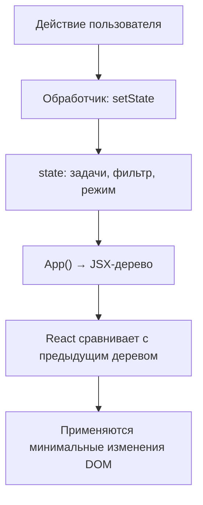
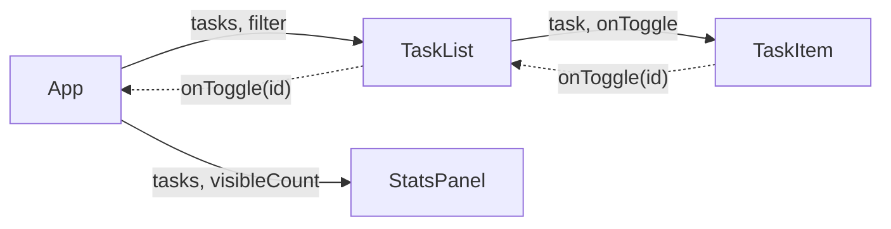
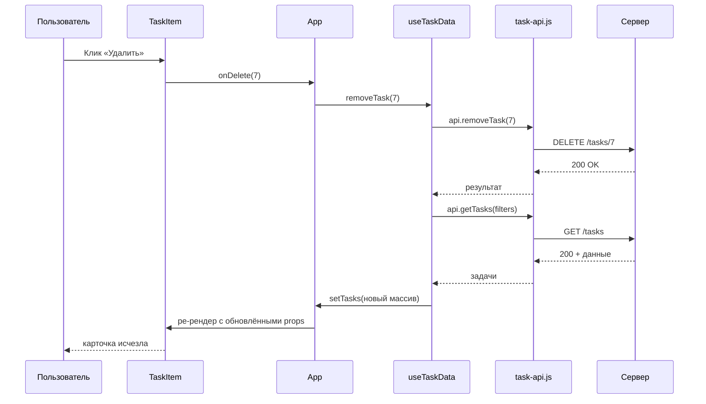

# Лекция № 4. React как декларативный слой интерфейса

**Дисциплина:** Технологии индустриального программирования
**Трек:** фулстек-разработка на JavaScript
**Связанные практические работы:** [ПР7 — Компоненты React и предметная модель](../../practices/practice-07/README.md), [ПР8 — Подключение React-приложения к API](../../practices/practice-08/README.md)
**Демонстрационный пример:** [React-список тем](./demo/)

[К описанию курса](../../README.md) · [К ПР7](../../practices/practice-07/README.md) · [К ПР8](../../practices/practice-08/README.md) · [Запустить пример](#13-демонстрационный-пример)

> Центральная идея лекции: интерфейс React-приложения описывается как функция от состояния. Разработчик пишет JSX — то, что должно быть на экране при данном `state`, — а React сам решает, какие изменения DOM выполнить. Это убирает ручную синхронизацию данных и представления, которая была основной работой в Лекциях 2 и 4 (DOM), и освобождает внимание для предметной области и интеграции с API.

## 1. Место лекции в курсе

В Лекциях 1–3 и практических работах ПР1–ПР6 студенты освоили:

- базовый JavaScript: типы, функции, объекты, массивы, модули;
- DOM, события, делегирование, формы и `localStorage` (ПР3, ПР4);
- асинхронное программирование, Promise, `fetch`, классификацию ошибок HTTP-клиента (Лекция 3, ПР5, ПР6).

Этого достаточно, чтобы построить работающее браузерное приложение «вручную»: состояние хранится в переменных, DOM обновляется в явной функции `render`, обработчики назначаются на постоянные контейнеры. На этом этапе становится заметно, что объём «склеивающего» кода — поиск элементов, отслеживание соответствия данных и DOM, повторная установка обработчиков — растёт быстрее, чем бизнес-логика.

React — библиотека, которая берёт на себя этот «склеивающий» слой. Вместо императивной команды «измени текст этого элемента» разработчик описывает, как должен выглядеть интерфейс при каждом возможном состоянии, и React сам синхронизирует DOM. Парадигма называется декларативной: **что** должно быть на экране, а не **как** этого добиться.

Лекция не учит React «с нуля» для новичков в программировании: студенты уже знают JavaScript, DOM и HTTP. Лекция вводит именно React-концепции поверх существующих знаний и связывает их с уже знакомыми контрактами `task-service.js`, `api-client.js` и `task-api.js` из ПР2 и Лекции 3.

### 1.1. Результаты обучения

После изучения материала необходимо уметь:

1. объяснить различие между императивным обновлением DOM и декларативным описанием интерфейса через JSX;
2. описать, что такое компонент, `props` и однонаправленный поток данных;
3. использовать `useState` для локального состояния и `useEffect` для побочных эффектов с правильным массивом зависимостей;
4. выполнять иммутабельные обновления массивов и объектов, чтобы React обнаружил изменения;
5. реализовывать управляемые формы с проверкой данных и привязкой ошибок к полям;
6. рендерить списки с обязательным `key` и применять условный рендеринг через `&&`, тернарный оператор и `null`;
7. выделять логику загрузки данных в кастомные хуки (например, `useTaskData`);
8. повторно использовать предметные функции `task-service.js` из ПР2 внутри React без изменений;
9. различать состояния `loading`, `ready`, `empty` и `error` в React-компонентах;
10. защищать интерфейс от гонки запросов через `AbortController` и проверку актуальности результата;
11. отлаживать React-приложение через React DevTools и точки останова в Sources.

### 1.2. Ориентировочный план занятия

| Этап | Время | Содержание |
|---|---:|---|
| Постановка задачи | 5 минут | Почему ручное обновление DOM перестаёт масштабироваться. |
| JSX и компоненты | 20 минут | Синтаксис, отличие от HTML, функциональные компоненты, props. |
| Состояние: useState | 15 минут | Иммутабельные обновления, батчинг, функциональные обновления. |
| Побочные эффекты: useEffect | 15 минут | Зависимости, очистка, типичные ошибки и бесконечные циклы. |
| Формы и списки | 15 минут | Управляемые input/select, key, условный рендеринг. |
| Интеграция с API | 15 минут | Кастомный хук useTaskData, состояния загрузки, гонка запросов. |
| Демонстрация и выводы | 5 минут | Разбор работающего примера и подготовка к ПР7–ПР8. |

Распределение времени является ориентиром. При разборе ошибок и вопросов отдельные блоки могут занимать больше времени.

## 2. От императивного DOM к декларативному UI

В Лекции 2 поток данных приложения выглядел так:

```text
действие пользователя → обработчик → изменение state.topics → render() → обновление DOM
```

Функция `render` сама создавала `li`, `span`, `button`, вызывала `replaceChildren` и `setAttribute`. Каждый обработчик знал, какой именно DOM-узел обновить. Это работало для учебного списка из четырёх задач, но по мере роста интерфейса начинало мешать:

- нужно было вручную синхронизировать видимые карточки с полным массивом;
- повторная установка обработчиков в `render` приводила к двойным срабатываниям;
- ошибка в одной ветке `render` ломала весь список;
- добавление нового состояния (например, режима редактирования) требовало правок в нескольких местах.

React предлагает другой подход. Разработчик описывает **дерево JSX** — то, что должно быть на экране при текущем состоянии. При изменении состояния React строит новое дерево, сравнивает его с предыдущим (этот процесс называется **reconciliation**) и применяет к DOM минимальный набор изменений.



Главный сдвиг: вместо «как изменить DOM» разработчик отвечает на вопрос «каким должен быть интерфейс при данном состоянии». Если состояние правильное, то и интерфейс правильный — рассинхронизация данных и DOM становится невозможной по построению.

Это не делает код автоматически корректным: по-прежнему нужно проверять входные данные, обрабатывать ошибки API и соблюдать иммутабельность. Но React убирает целый класс ошибок, связанных с ручным управлением DOM, и позволяет сосредоточиться на бизнес-логике.

## 3. JSX: расширение синтаксиса JavaScript

**JSX** — расширение синтаксиса JavaScript, позволяющее писать разметку, похожую на HTML, прямо в коде компонентов. JSX не является строкой и не разбирается браузером как HTML: он компилируется (обычно сборщиком Vite или Babel) в вызовы `React.createElement`.

```jsx
const heading = <h1 className="hero">Список тем</h1>;
```

После компиляции это превращается в:

```javascript
const heading = React.createElement(
  "h1",
  { className: "hero" },
  "Список тем",
);
```

На практике разработчик видит и пишет JSX, а сборщик берёт на себя преобразование.

### 3.1. Отличия от HTML

JSX внешне похож на HTML, но имеет отличия, вытекающие из того, что это JavaScript:

| HTML | JSX | Причина |
|---|---|---|
| `class="topic-card"` | `className="topic-card"` | `class` — зарезервированное слово в JavaScript. |
| `for="title"` | `htmlFor="title"` | `for` — зарезервированное слово. |
| `tabindex="0"` | `tabIndex={0}` | Имена атрибутов в camelCase. |
| `data-task-id="4"` | `data-task-id="4"` | `data-*` остаются в kebab-case. |
| `aria-pressed="true"` | `aria-pressed="true"` | `aria-*` остаются в kebab-case. |
| `<input disabled>` | `<input disabled={true} />` | Логические атрибуты требуют выражение. |
| `<label for="x">` | `<label htmlFor="x">` | См. выше. |

Все теги без явного закрывающего тега должны быть самозакрывающимися: `<input />`, ``, `<br />`. В HTML это необязательно, в JSX — обязательно.

### 3.2. Выражения в JSX

Внутри JSX можно встраивать любое JavaScript-выражение, заключив его в фигурные скобки:

```jsx
function StatsPanel({ tasks, visibleCount }) {
  const total = tasks.length;
  const completed = tasks.filter((t) => t.completed).length;
  const progress = total === 0 ? 0 : (completed / total) * 100;

  return (
    <dl className="summary-grid">
      <dt>Всего</dt>
      <dd>{total}</dd>
      <dt>Прогресс</dt>
      <dd>{progress.toFixed(1)}%</dd>
      <dt>Показано</dt>
      <dd>{visibleCount}</dd>
    </dl>
  );
}
```

В фигурных скобках может быть переменная, вызов функции, тернарный оператор, `map` для списка. Нельзя вставлять **операторы** вроде `if` или `for` — только выражения. Условную логику выносят в переменную выше или используют тернарный оператор.

### 3.3. Один корневой элемент

JSX-выражение должно возвращать один корневой элемент. Несколько соседних элементов без общего родителя недопустимы:

```jsx
// Ошибка: два корневых элемента
return (
  <h1>Заголовок</h1>
  <p>Подзаголовок</p>
);
```

Решений два: обернуть в `<div>` или использовать фрагмент — пустой тег `<>...</>`:

```jsx
return (
  <>
    <h1>Заголовок</h1>
    <p>Подзаголовок</p>
  </>
);
```

Фрагмент не создаёт лишнего DOM-узла. Это полезно, когда wrapper нарушает структуру (например, в `<ul>`可以直接 вкладывать только `<li>`).

### 3.4. Что не рендерится

React выводит только то, что имеет видимое представление:

- `true`, `false`, `null` и `undefined` не выводят ничего;
- `0` выводится как `0` (это частая ловушка при использовании `&&`);
- пустая строка `""` не выводится;
- массивы разворачиваются поэлементно (при наличии `key`).

Ловушка с `0`:

```jsx
{tasks.length && <TaskList tasks={tasks} />}
```

Если `tasks.length === 0`, на экране появится `0`, а не пустое место. Корректный вариант:

```jsx
{tasks.length > 0 && <TaskList tasks={tasks} />}
// или
{tasks.length === 0 ? <EmptyMessage /> : <TaskList tasks={tasks} />}
```

## 4. Компоненты и props

**Компонент** — это функция, принимающая объект `props` и возвращающая JSX. Имя компонента обязано начинаться с большой буквы: `TaskList`, `StatsPanel`, `App`. Маленькая буква (`task-list`) трактуется React как HTML-тег.

```jsx
function TaskItem({ task, onToggle, onDelete }) {
  return (
    <li className="task-card">
      <span className="task-card__title">{task.title}</span>
      <button type="button" onClick={() => onToggle(task.id)}>
        {task.completed ? "Вернуть" : "Выполнить"}
      </button>
    </li>
  );
}
```

Здесь `task`, `onToggle` и `onDelete` — props. Props — это входные данные компонента, аналогичные аргументам функции. Компонент не должен их изменять: props **read-only**.

### 4.1. Передача props

Родительский компонент передаёт props через атрибуты JSX:

```jsx
function TaskList({ tasks, onToggle, onDelete }) {
  return (
    <ul className="topic-list">
      {tasks.map((task) => (
        <TaskItem
          key={task.id}
          task={task}
          onToggle={onToggle}
          onDelete={onDelete}
        />
      ))}
    </ul>
  );
}
```

Строки передаются в кавычках: `className="topic-card"`. Числа, логические значения, объекты, функции и переменные — в фигурных скобках: `tabIndex={0}`, `onClick={handleClick}`, `task={task}`.

### 4.2. Однонаправленный поток данных

Данные в React движутся строго сверху вниз: родитель передаёт данные потомку через props, потомок передаёт события наверх через callback'и. Это правило называется **one-way data flow** и является ключевым для отладки: изменилось значение в `<TaskItem>` — значит, родитель `<TaskList>` передал новый `task`, а изменить `task` сам `TaskItem` не мог.



Пунктирная линия — восходящий поток событий (вызов callback'а). Сплошная — нисходящий поток данных (передача props).

### 4.3. Декомпозиция интерфейса

Список тем из Лекции 2 естественным образом разбивается на компоненты:

| Компонент | Отвечает за |
|---|---|
| `App` | Состояние, оркестрация, связь между компонентами. |
| `StatsPanel` | Отображение сводки (всего, выполнено, осталось, прогресс). |
| `Filters` | Кнопки фильтров и их активное состояние. |
| `TaskList` | Контейнер для карточек, отрисовка `tasks.map(...)`. |
| `TaskItem` | Одна карточка: название, приоритет, кнопки. |
| `TaskForm` | Управляемая форма создания и редактирования. |

Каждый компонент решает одну задачу и может быть рассмотрен в изоляции. Это упрощает тестирование и переиспользование: `TaskItem` ничего не знает о фильтре, источнике данных или состоянии редактирования.

### 4.4. `children` и композиция

Для компонентов-обёрток используется специальный prop `children`:

```jsx
function Panel({ title, children }) {
  return (
    <section className="panel">
      <h2>{title}</h2>
      {children}
    </section>
  );
}

// Использование
<Panel title="Список задач">
  <Filters value={filter} onChange={setFilter} />
  <TaskList tasks={visibleTasks} />
</Panel>
```

`children` — это всё, что передано между открывающим и закрывающим тегами компонента. Этот приём позволяет создавать переиспользуемые обёртки без жёсткой фиксации содержимого.

## 5. Состояние компонента: useState

Props — внешние данные. **Состояние** (state) — внутренние данные компонента, которые могут меняться со временем. В функциональных компонентах состояние создаётся хуком `useState`:

```jsx
import { useState } from "react";

function App() {
  const [tasks, setTasks] = useState([]);
  const [filter, setFilter] = useState("all");
  // ...
}
```

`useState(initialValue)` возвращает массив из двух элементов: текущее значение и функцию-сеттер. По соглашению их называют `[value, setValue]` через деструктуризацию.

### 5.1. Иммутабельность состояния

Сеттер **не мутирует** существующий объект — он заменяет значение на новое. Поэтому нельзя писать:

```jsx
// НЕЛЬЗЯ: мутация существующего массива
tasks.push(newTask);
setTasks(tasks);
```

React сравнивает ссылки. Если передать тот же массив, React решит, что ничего не изменилось, и не запустит повторный рендер. Правильно — создавать новый массив:

```jsx
// ПРАВИЛЬНО: новый массив через spread
setTasks([...tasks, newTask]);

// ПРАВИЛЬНО: новый массив через map
setTasks(tasks.map((t) =>
  t.id === id ? { ...t, completed: !t.completed } : t,
));

// ПРАВИЛЬНО: новый массив через filter
setTasks(tasks.filter((t) => t.id !== id));
```

Это те же операции `spread`, `map` и `filter`, что и в ПР2. Принципы иммутабельного обновления предметных массивов, освоенные в `task-service.js`, переносятся в React без изменений.

### 5.2. Функциональные обновления

Если новое состояние зависит от предыдущего, безопаснее использовать **функциональную форму** `setState`:

```jsx
// НЕБЕЗОПАСНО: state может быть устаревшим при нескольких быстрых обновлениях
setTasks([...tasks, newTask]);

// БЕЗОПАСНО: React передаёт актуальное предыдущее значение
setTasks((prev) => [...prev, newTask]);
```

Это особенно важно при батчинге — объединении нескольких обновлений в одно. React 18 автоматически батчит обновления внутри обработчиков событий, таймеров и промисов. Если между вызовами `setTasks` значение `tasks` не успевает обновиться в замыкании, функциональная форма гарантирует корректность.

### 5.3. Состояние — минимальный источник истины

Хорошее правило: **не дублируйте в состоянии то, что можно вычислить**. Если в `tasks` хранится полный массив, то количество невыполненных задач — это производное значение:

```jsx
const completed = tasks.filter((t) => t.completed).length;
const pending = tasks.length - completed;
```

Не нужно отдельного `useState` для `completedCount`. Если бы такое состояние было, его пришлось бы синхронизировать с `tasks` вручную — это типичный источник багов.

То же касается фильтрации: видимый список — производное от `tasks` и `filter`, а не отдельное состояние:

```jsx
const visibleTasks = tasks.filter((task) => {
  if (filter === "pending") return !task.completed;
  if (filter === "completed") return task.completed;
  return true;
});
```

### 5.4. Где живёт состояние

Состояние принадлежит тому компоненту, в котором вызвано `useState`. Если дочернему компоненту нужны данные — родитель передаёт их через props. Если двум компонентам нужно одно состояние — оно поднимается к их общему родителю (**lifting state up**).

```text
App: tasks, filter, editingId
 ├─ TaskForm: локальный draft формы
 ├─ StatsPanel: получает tasks и visibleCount через props
 ├─ Filters: получает value и onChange через props
 └─ TaskList: получает tasks и callback'и через props
     └─ TaskItem: получает task и callback'и через props
```

В демо к лекции `App` — единственный источник истины для `tasks`, `filter` и `editingId`. `TaskForm` имеет собственное локальное состояние `draft` (значения полей), потому что эти данные нужны только внутри формы и не представляют интереса для остального приложения до отправки.

## 6. Побочные эффекты: useEffect

`useState` описывает, **что** отображать. `useEffect` описывает, **что делать дополнительно** к рендерингу: запросить данные с сервера, подписаться на событие, запустить таймер, синхронизировать с `localStorage`. Такие действия называются побочными эффектами, потому что они влияют на что-то за пределами функции компонента.

```jsx
import { useEffect, useState } from "react";

function useTaskData() {
  const [tasks, setTasks] = useState([]);
  const [status, setStatus] = useState("loading");

  useEffect(() => {
    let cancelled = false;
    (async () => {
      const result = await api.getTasks();
      if (!cancelled) {
        setTasks(result.tasks);
        setStatus(result.tasks.length === 0 ? "empty" : "ready");
      }
    })();
    return () => {
      cancelled = true;
    };
  }, []);

  // ...
}
```

### 6.1. Массив зависимостей

Третий аргумент `useEffect` — массив значений, от которых зависит эффект:

| Массив | Когда выполняется эффект |
|---|---|
| `[]` | Один раз после монтирования компонента. |
| `[value]` | После монтирования и при каждом изменении `value`. |
| Без массива | После каждого рендера (почти всегда ошибка). |

Если в эффекте используется значение из области видимости компонента (`filter`, `tasks`, какая-то пропса), оно должно быть в массиве зависимостей. React выдаст предупреждение, если забыта зависимость.

```jsx
// Загрузка задач при смене фильтра
useEffect(() => {
  let cancelled = false;
  api.getTasks({ completed: filter === "completed" ? true : filter === "pending" ? false : null })
    .then((result) => {
      if (!cancelled) setTasks(result.tasks);
    });
  return () => { cancelled = true; };
}, [filter]); // filter — зависимость
```

### 6.2. Очистка эффекта

Если эффект что-то создаёт (подписку, таймер, запрос), он должен вернуть функцию очистки, чтобы не оставить «висящие» обработчики после размонтирования:

```jsx
useEffect(() => {
  const timer = setInterval(() => console.log("tick"), 1000);
  return () => clearInterval(timer);
}, []);
```

Это же касается запросов: если компонент размонтировался до получения ответа, попытка вызвать `setTasks` на размонтированном компоненте вызовет предупреждение. Решение — флаг `cancelled`:

```jsx
useEffect(() => {
  let cancelled = false;
  fetchData().then((data) => {
    if (!cancelled) setData(data);
  });
  return () => { cancelled = true; };
}, []);
```

### 6.3. Бесконечный цикл

Самая частая ошибка с `useEffect` — бесконечный цикл обновлений:

```jsx
// ОШИБКА: setTasks вызывает ре-рендер, эффект запускается заново
useEffect(() => {
  setTasks(prev => [...prev, { id: Date.now(), title: "Новая" }]);
});
```

Здесь массив зависимостей не передан, эффект выполняется после каждого рендера. Внутри вызывается `setTasks` — это меняет состояние и вызывает ре-рендер — эффект снова запускается. Цикл.

Правила, помогающие избежать цикла:

- если эффект обновляет состояние, от которого зависит, добавьте условие выхода или вынесите обновление в обработчик события;
- всегда передавайте массив зависимостей (пусть даже пустой);
- различайте «выполнить один раз при появлении» (`[]`) и «выполнить при изменении X» (`[X]`).

### 6.4. Что НЕ делать в `useEffect`

`useEffect` — не утилита общего назначения. В частности:

- не нужно обновлять DOM напрямую через `document.querySelector` — React это делает сам;
- не нужно подписываться на `store` или контекст, если есть специализированные хуки (`useContext`, `useSyncExternalStore`);
- не нужно вычислять производные значения — для этого есть обычный код в теле компонента;
- не нужно превращать `useEffect` в аналог `componentDidMount` классовых компонентов: мышление «выполнить один раз» часто скрывает зависимость, которую нужно объявить явно.

Подробное обсуждение того, что не нужно делать в `useEffect`, есть в официальном руководстве [You Might Not Need an Effect](https://react.dev/learn/you-might-not-need-an-effect).

## 7. Управляемые формы и события

В Лекции 2 форма обрабатывалась через `submit`, `FormData` и `setCustomValidity`. В React подход тот же, но значение поля хранится в состоянии компонента, а не в DOM. Это называется **управляемым компонентом**:

```jsx
function TaskForm({ onSubmit }) {
  const [draft, setDraft] = useState({ id: "", title: "", priority: "medium" });

  function handleSubmit(event) {
    event.preventDefault();
    onSubmit(draft);
  }

  return (
    <form onSubmit={handleSubmit}>
      <input
        type="text"
        value={draft.title}
        onChange={(e) => setDraft({ ...draft, title: e.target.value })}
      />
      <select
        value={draft.priority}
        onChange={(e) => setDraft({ ...draft, priority: e.target.value })}
      >
        <option value="low">Низкий</option>
        <option value="medium">Средний</option>
        <option value="high">Высокий</option>
      </select>
      <button type="submit">Добавить</button>
    </form>
  );
}
```

Значение поля ввода (`value`) читается из состояния. Изменение пользователем (`onChange`) обновляет состояние. React перерисовывает поле уже с новым значением. Цикл замыкается.

### 7.1. `preventDefault` обязателен

Без `event.preventDefault()` браузер выполнит стандартное действие: перезагрузит страницу с GET-параметрами из формы. В React-приложении это разрушит состояние. Поэтому в начале обработчика `submit` всегда стоит `preventDefault()`.

### 7.2. Валидация — две границы

Принцип из Лекции 2 сохраняется: проверка формы делится на нативную (HTML-атрибуты `required`, `maxLength`, `min`) и прикладную (логика предметной области). В React к ним добавляется состояние ошибок, которое хранится в компоненте:

```jsx
function TaskForm({ onSubmit, tasks }) {
  const [draft, setDraft] = useState({ id: "", title: "", priority: "medium" });
  const [errors, setErrors] = useState({});

  function handleSubmit(event) {
    event.preventDefault();
    const result = validateTaskDraft(draft, tasks);
    if (!result.ok) {
      setErrors(result.errors);
      return;
    }
    setErrors({});
    onSubmit(result.value);
  }

  return (
    <form onSubmit={handleSubmit}>
      <input
        value={draft.title}
        onChange={(e) => {
          setDraft({ ...draft, title: e.target.value });
          setErrors((prev) => ({ ...prev, title: undefined }));
        }}
        aria-invalid={Boolean(errors.title)}
      />
      {errors.title && <small className="field-error">{errors.title}</small>}
    </form>
  );
}
```

`validateTaskDraft` — та же чистая функция из ПР2/ПР4, не обращающаяся к DOM. Её можно протестировать в Node.js и переиспользовать в любом UI.

### 7.3. События в React vs нативные события

React оборачивает нативные события в синтетические (`SyntheticEvent`), которые ведут себя одинаково во всех браузерах. Большую часть времени разработчик использует `event.target.value` (для полей), `event.target.checked` (для чекбоксов) и `event.preventDefault()`.

В React **нельзя** вернуть `false` из обработчика, чтобы отменить стандартное действие — это работало в старом jQuery, но не в современных событиях DOM. Нужно явно вызвать `event.preventDefault()`.

## 8. Списки, ключи и условный рендеринг

### 8.1. Рендеринг массива

React умеет рендерить массивы элементов напрямую. Если в JSX вставить массив, React развернёт его поэлементно:

```jsx
function TaskList({ tasks }) {
  return (
    <ul>
      {tasks.map((task) => (
        <li key={task.id}>{task.title}</li>
      ))}
    </ul>
  );
}
```

### 8.2. Зачем нужен `key`

`key` — специальный prop, который помогает React определить, какой элемент массива какой. При повторном рендере React сравнивает `key` старого и нового массива:

- если `key` совпадает — React переиспользует существующий DOM-узел и обновляет только изменившиеся props;
- если `key` нового нет среди старых — создаётся новый узел;
- если старый `key` исчез из нового массива — узел удаляется.

Без `key` React выдаст предупреждение и будет по умолчанию использовать индекс, что часто приводит к ошибкам.

### 8.3. Почему индекс — плохой `key`

Если список можно переупорядочить, отфильтровать или удалить из середины, индексы смещаются и React путает элементы. Пример:

```text
Состояние A: tasks = [T1, T2, T3]   индексы: 0, 1, 2
Состояние B: tasks = [T2, T3]        индексы: 0, 1
```

React увидит: «T1 был по индексу 0, теперь там T2 — обновлю текст». Но T2 — это уже другой объект с другим внутренним состоянием (например, локальным состоянием ввода). Правильно — использовать стабильный идентификатор предметной области:

```jsx
<li key={task.id}>...</li>
```

`id` не меняется при фильтрации или сортировке, поэтому React корректно определит, какие элементы удалены, а какие — переиспользованы.

### 8.4. Условный рендеринг

В React нет специальной директивы `v-if` или `*ngIf`. Условный рендеринг делается средствами JavaScript:

**Тернарный оператор** — когда нужно показать одно из двух:

```jsx
{tasks.length === 0 ? <EmptyMessage /> : <TaskList tasks={tasks} />}
```

**Логическое `&&`** — когда нужно показать или ничего:

```jsx
{hasError && <ErrorMessage text={error} />}
```

**Ранний возврат** — для читаемости:

```jsx
function TaskList({ tasks }) {
  if (tasks.length === 0) {
    return <p className="empty-message">Список пуст.</p>;
  }
  return <ul>{tasks.map(/* ... */)}</ul>;
}
```

Ранний возврат особенно полезен для проверки состояний `loading` и `error` перед основной отрисовкой.

### 8.5. Производные выборки — без отдельного состояния

В Лекции 2 подчёркивалось: «Фильтр не должен уничтожать элементы исходного массива». В React этот принцип реализуется естественнее — через производное значение в теле компонента:

```jsx
function App() {
  const [tasks, setTasks] = useState(initialTasks);
  const [filter, setFilter] = useState("all");

  const visibleTasks = tasks.filter((task) => {
    if (filter === "pending") return !task.completed;
    if (filter === "completed") return task.completed;
    return true;
  });

  // При рендере используем visibleTasks, но в setTasks передаём полный массив
  return (
    <>
      <Filters value={filter} onChange={setFilter} />
      <TaskList tasks={visibleTasks} />
    </>
  );
}
```

При смене фильтра меняется только `filter`, а `tasks` остаётся неизменным. React пересчитывает `visibleTasks` и обновляет только `TaskList`. Полный массив задач не теряется.

## 9. Интеграция с API: кастомные хуки

В Лекции 3 был построен HTTP-клиент `api-client.js` и предметный слой `task-api.js`. В React-приложении они переиспользуются без изменений: `task-api.js` не знает о React и не должен знать. Связку с состоянием компонента берёт на себя **кастомный хук** — функция, имя которой начинается с `use` и которая внутри вызывает другие хуки.

```jsx
import { useEffect, useState } from "react";
import { createApiClient } from "./api-client.js";
import { createTaskApi } from "./task-api.js";

const client = createApiClient({ baseUrl: API_URL, timeoutMs: 3000 });
const api = createTaskApi(client);

export function useTaskData(filters) {
  const [tasks, setTasks] = useState([]);
  const [status, setStatus] = useState("loading");
  const [error, setError] = useState("");

  useEffect(() => {
    const controller = new AbortController();
    setStatus("loading");
    api.getTasks(filters, { signal: controller.signal })
      .then((result) => {
        setTasks(result.tasks);
        setStatus(result.tasks.length === 0 ? "empty" : "ready");
      })
      .catch((err) => {
        if (err.kind === "aborted") return;
        setStatus("error");
        setError(err.message);
      });
    return () => controller.abort();
  }, [JSON.stringify(filters)]);

  return { tasks, status, error };
}
```

Хук `useTaskData` инкапсулирует:

- состояние `tasks`, `status`, `error`;
- загрузку при монтировании и при смене `filters`;
- отмену предыдущего запроса при новой загрузке;
- классификацию ошибок через `ApiError` из Лекции 3.

Компонент `App` использует этот хук и не знает о `fetch`, `AbortController` или `ApiError`:

```jsx
function App() {
  const { tasks, status, error } = useTaskData({ completed: false, priority: "high" });
  if (status === "loading") return <LoadingScreen />;
  if (status === "error") return <ErrorScreen message={error} />;
  if (status === "empty") return <EmptyScreen />;
  return <TaskList tasks={tasks} />;
}
```

### 9.1. Почему хук — функция с `use`-префиксом

Это не прихоть линтера: префикс `use` — сигнал для правил хуков React (rules of hooks). Хуки можно вызывать только:

- на верхнем уровне функционального компонента или другого хука;
- не внутри условий, циклов или вложенных функций.

Это гарантирует, что порядок вызовов хуков в компоненте стабилен между рендерами — на этом основана внутренняя реализация `useState` и `useEffect`. Префикс `use` позволяет линтеру `eslint-plugin-react-hooks` проверить, что вы не нарушаете правила.

### 9.2. Зависимость от объектов

Если `filters` — объект, передача его в массив зависимостей проблематична: при каждом рендере создаётся новый объект, и эффект будет срабатывать на каждом рендере. Решения:

- стабилизировать ссылку через `useMemo`;
- передавать в массив зависимостей сериализованное представление: `[JSON.stringify(filters)]`;
- разбить объект на примитивные поля: `[filters.completed, filters.priority]`.

В ПР8 используется `useMemo` или сериализация — оба варианта допустимы, главное — стабильность ссылки, от которой зависит эффект.

## 10. Состояния интерфейса и гонка запросов

### 10.1. Четыре состояния

В Лекции 3 введены состояния `loading`, `ready`, `empty`, `error`. В React они реализуются как одно поле состояния:

```jsx
const [status, setStatus] = useState("loading"); // | "ready" | "empty" | "error"
```

Или как несколько булевых полей — выбор зависит от предпочтений команды. Поле статуса удобнее: оно исключает одновременную истинность нескольких состояний.

`empty` не является ошибкой. Это нормальный результат: либо фильтр не нашёл задач, либо сервер действительно вернул пустой массив.

### 10.2. Гонка запросов

Если пользователь быстро меняет фильтры (например, кликает по «В работе», затем по «Выполненные»), запускаются два запроса. Ответ первого может прийти позже второго и перезаписать актуальный результат. Это и есть гонка запросов.

В Лекции 3 предложены два механизма защиты:

1. `AbortController` — отменяет предыдущий запрос при новом.
2. Проверка актуальности результата — например, через номер загрузки.

В React-эффекте оба механизма комбинируются:

```jsx
useEffect(() => {
  let cancelled = false;
  const controller = new AbortController();

  api.getTasks(filters, { signal: controller.signal })
    .then((result) => {
      if (!cancelled) {
        setTasks(result.tasks);
        setStatus("ready");
      }
    })
    .catch((err) => {
      if (err.kind === "aborted") return;
      if (!cancelled) {
        setStatus("error");
        setError(err.message);
      }
    });

  return () => {
    cancelled = true;
    controller.abort();
  };
}, [JSON.stringify(filters)]);
```

Флаг `cancelled` защищает от ситуации, когда запрос нельзя отменить (например, в тестовой среде с фейковым `fetch`). `controller.abort()` отменяет реальный сетевой запрос. Ошибка отмены (`kind === "aborted"`) не показывается пользователю — это штатное управление потоком, а не сбой.

### 10.3. Пессимистическое обновление

После мутации (`POST`, `PATCH`, `DELETE`) приложение не оптимистично обновляет локальный массив, а повторно запрашивает список с текущими фильтрами:

```text
клик «Удалить» → POST/DELETE → успешный ответ → повторный GET /tasks → отрисовка
```

Это надёжнее: данные в интерфейсе всегда согласованы с сервером. Минус — лишний запрос, но для учебного приложения это приемлемо.

```jsx
async function handleDelete(id) {
  try {
    await api.removeTask(id);
    const result = await api.getTasks(filters);
    setTasks(result.tasks);
  } catch (err) {
    setStatus("error");
    setError(err.message);
  }
}
```

### 10.4. Блокировка на время мутации

Пока идёт запрос изменения, кнопки действий блокируются, чтобы двойной клик не создал два одинаковых запроса:

```jsx
const [pendingAction, setPendingAction] = useState(false);

async function handleDelete(id) {
  if (pendingAction) return;
  setPendingAction(true);
  try {
    await api.removeTask(id);
    // ... перезагрузка
  } finally {
    setPendingAction(false);
  }
}

// В кнопке:
<button disabled={pendingAction} onClick={() => handleDelete(task.id)}>
  Удалить
</button>
```

## 11. Разделение ответственности в React-приложении

Главное преимущество React — предметная логика и UI-логика разделены по разным модулям. Структура ПР7–ПР8 повторяет слои из ПР2–ПР4:

| Файл | Ответственность | Знает ли о React? |
|---|---|---|
| `domain/task-service.js` | Чистые функции: `createTask`, `findTaskById`, `setTaskCompleted`, `removeTask`. Те же контракты, что в ПР2. | Нет. |
| `api-client.js` | Транспорт: `fetch`, `Response`, `ApiError`. Из Лекции 3. | Нет. |
| `task-api.js` | Предметные маршруты: `/tasks`, `/categories`, проверка схемы. | Нет. |
| `hooks/useTaskData.js` | Связывает API и React-состояние. | Да. |
| `components/TaskList.jsx` | Только UI: принимает `tasks` и `onToggle`, рисует список. | Да. |
| `components/TaskForm.jsx` | Только UI: управляемая форма, локальный draft, ошибки полей. | Да. |
| `App.jsx` | Оркестрация: состояние, обработчики, композиция компонентов. | Да. |

`task-service.js` из ПР2 переносится в ПР7 **без изменений**. Это важный момент:分层设计, начатый в ПР2, окупается — предметный код не зависит от UI и переиспользуется в любой среде, от консоли до React.

### 11.1. Почему `task-service.js` не знает о React

Если бы `task-service.js` импортировал React или обращался к DOM, его нельзя было бы:

- запускать в Node.js (например, для проверки в `domain.test.js`);
- переиспользовать в будущих UI-фреймворках или в серверных сценариях;
- тестировать в изоляции от React DevTools и браузера.

Поэтому правило из Лекции 2 сохраняется: прикладной модуль зависит только от своих аргументов и возвращает данные. Компонент React импортирует `task-service.js`, но не наоборот.

### 11.2. Поток одного действия

Рассмотрим удаление задачи `id = 7` в React-приложении с интеграцией API:



Каждый слой отвечает за свою часть: `TaskItem` только сообщает о клике, `App` передаёт команду в хук, хук вызывает API, API общается с сервером. Слои не перемешиваются.

## 12. Отладка React-приложения

React-приложение отлаживается теми же инструментами, что и обычный JavaScript, плюс специализированные расширения.

### 12.1. React DevTools

Расширение браузера **React DevTools** добавляет во вкладку Elements две новые панели:

- **Components** — дерево компонентов с текущими `props` и `state`. Можно поставить точку останова на изменение состояния конкретного компонента.
- **Profiler** — запись рендеров для анализа производительности: какой компонент сколько времени занял, почему произошёл ре-рендер.

Без DevTools отладка React превращается в угадывание. Установите расширение до начала ПР7.

### 12.2. Sources и breakpoints

Точки останова в Sources работают в JSX-коде (если используется Vite или Babel с source maps). Можно поставить breakpoint на строке `setTasks(...)` и посмотреть:

- стек вызовов (от обработчика клика до React-reconciler'а);
- текущие значения `tasks`, `filter`, `editingId` в Scope;
- значение `event.target` и `event.currentTarget`.

### 12.3. Частые симптомы

| Симптом | Вероятная причина | Что проверить |
|---|---|---|
| Бесконечный ре-рендер | `useEffect` без массива зависимостей или с обновлением состояния внутри | Массив зависимостей и условия выхода из эффекта. |
| Состояние «отстаёт» | Использование `tasks` вместо `prev` в `setTasks` | Форма `setTasks(prev => ...)` для обновлений от предыдущего. |
| Карточки путаются при фильтрации | Использование индекса массива как `key` | Заменить на стабильный `task.id`. |
| Эффект не запускается | Зависимость — новый объект на каждом рендере | `useMemo` или `JSON.stringify(filters)` в массиве зависимостей. |
| `0` выводится вместо пустого места | `{count && <Component />}` при `count === 0` | `{count > 0 && ...}` или тернарник. |
| Повторный ре-рендер всего дерева | Новый объект `style={{ ... }}` или новая функция-обработчик на каждом рендере | `useMemo` для объектов, `useCallback` для функций (если производительность критична). |
| Запрос уходит дважды | Strict Mode в React 18 дважды вызывает эффекты в dev-режиме | Это ожидаемое поведение для dev. В production эффект срабатывает один раз. |
| Карточка исчезает, но в DOM остаётся | Несогласованный `key` между рендерами | Использовать стабильный `task.id`, не `Math.random()` и не индекс. |
| `Cannot read property 'map' of undefined` | Props не переданы или имеют неверную форму | Проверить, что родитель передаёт массив; защититься `tasks ?? []`. |
| Форма не отправляется по Enter | Нет `onSubmit` на `<form>`, только `onClick` на кнопке | Обработчик `submit` именно формы, кнопка `type="submit"`. |

### 12.4. Проверка через React DevTools Profiler

Если интерфейс «тормозит», Profiler покажет:

- какой компонент ре-рендерится дольше всех;
- почему произошёл ре-рендер (изменились props, изменилось state, родитель ре-рендерился);
- какие дочерние компоненты ре-рендерились «за компанию».

Частая оптимизация — оборачивание компонента в `React.memo`, чтобы он не ре-рендерился, если props не изменились. Но это нужно только когда измерения Profiler подтверждают проблему: преждевременная оптимизация усложняет код.

## 13. Демонстрационный пример

В каталоге [`demo`](./demo/) находится React-приложение «Темы для повторения» — то же по функциональности, что и демо Лекции 2, но реализованное через компоненты и хуки. Оно показывает:

- функциональные компоненты `App`, `StatsPanel`, `Filters`, `TaskList`, `TaskItem`, `TaskForm`;
- `useState` для `tasks`, `filter`, `editingId`, `draft`, `errors`;
- `useEffect` с пустым массивом зависимостей для загрузки при монтировании;
- имитацию API через промисы с задержкой (вместо реального сервера);
- управляемую форму с валидацией;
- список с `key={task.id}`;
- производную выборку `visibleTasks` без отдельного состояния;
- сохранение в `localStorage` и сброс данных;
- состояния `loading` и `ready`.

### 13.1. Запуск

Из каталога `lectures/lecture-04/demo`:

```bash
npm start
```

Затем открыть:

```text
http://127.0.0.1:5504/
```

Для проверки синтаксиса сервера:

```bash
npm run check
```

React и ReactDOM подключаются с CDN как ES-модули, а JSX компилируется в браузере через Babel Standalone. Это удобно для демонстрации: не нужна сборка. В ПР7 и ПР8 используется Vite, который компилирует JSX заранее, и приложение загружается быстрее.

### 13.2. Сценарий демонстрации

1. Открыть DevTools и React DevTools. В панели Components найти `App` и показать его `state`.
2. Добавить тему `id = 20`, «Изучить useState», приоритет «Высокий». В React DevTools увидеть изменение `tasks`.
3. Кликнуть «Выполнить» для `id = 4`. Поставить breakpoint в `handleToggle` и проверить, что `tasks` до вызова — старый массив, а после `await` — новый.
4. Переключить фильтр на «В работе». Убедиться, что `tasks` остался полным, а `visibleTasks` — производное значение.
5. Нажать «Изменить» на карточке. Форма переходит в режим редактирования: поле `id` блокируется, кнопка меняет подпись. В React DevTools видно изменение `editingId`.
6. Сбросить пример. В Application → Local Storage удалить ключ `tip-js:lecture-04:tasks` и обновить страницу — данные восстановятся из исходных.
7. Внести в `localStorage` повреждённый JSON `{{broken`. Перезагрузить. Приложение должно восстановить исходные данные (логика в `readStored`).
8. В React DevTools Profiler записать серию кликов и увидеть, какие компоненты ре-рендерятся.

Демонстрационный пример показывает архитектурный принцип, но не является готовым решением ПР7 или ПР8: предметная область, контракты функций, структура модулей и проверяемые требования практических работ отличаются.

## 14. Связь с практическими работами

### ПР7: Компоненты React и предметная модель

В ПР7 основные идеи лекции применяются к интерфейсу системы управления задачами:

- `task-service.js` из ПР2 переносится в `domain/` без изменений;
- `data.js` подключается к React-компонентам;
- создаются компоненты `TaskList`, `TaskItem`, `TaskForm`, `TaskFilters`, `TaskStats`;
- состояние `tasks` и `filter` хранится в `App`;
- форма обрабатывается через `submit` и `useState`;
- проверяются обычные, граничные и некорректные данные;
- автоматические проверки (`domain.test.js`) подтверждают, что предметный код работает в изоляции от React.

### ПР8: Подключение React-приложения к API

В ПР8 добавляется интеграция с сервером из Лекции 3:

- `api-client.js` и `task-api.js` переиспользуются без изменений;
- хук `useTaskData` загружает задачи с реального HTTP-сервера;
- реализуются состояния `loading`, `ready`, `empty`, `error`;
- гонка запросов при смене фильтра обрабатывается через `AbortController`;
- после мутации (`POST`, `PATCH`, `DELETE`) выполняется повторный `GET`;
- форма валидируется до отправки на сервер;
- проверяются интеграция с реальным API и устойчивость к ошибкам.

Главный переход между работами: ПР7 отвечает на вопрос «как описать интерфейс компонентами и переиспользовать предметную модель», а ПР8 — «как связать это с сервером и управлять асинхронными состояниями».

| Концепция лекции | ПР7 | ПР8 |
|---|---|---|
| Компоненты и props | ✓ основа | ✓ переиспользуется |
| `useState` и иммутабельность | ✓ | ✓ |
| `useEffect` для загрузки | — | ✓ основа |
| Управляемые формы | ✓ | ✓ |
| Списки и `key` | ✓ | ✓ |
| Кастомный хук `useTaskData` | — | ✓ основа |
| Состояния loading/ready/empty/error | — | ✓ основа |
| Гонка запросов и `AbortController` | — | ✓ основа |
| `task-service.js` из ПР2 | ✓ переиспользован | ✓ переиспользован |
| `api-client.js` из Лекции 3 | — | ✓ переиспользован |

## 15. Итоги

1. React — декларативный слой поверх DOM: разработчик описывает, **что** должно быть на экране при данном состоянии, а React сам синхронизирует DOM.
2. JSX — расширение JavaScript, компилируемое в `React.createElement`. Отличия от HTML: `className`, `htmlFor`, camelCase-атрибуты, обязательное самозакрытие тегов.
3. Компонент — функция от `props` к JSX. Имя с большой буквы. Props — read-only.
4. Данные движутся сверху вниз (props), события — снизу вверх (callback'и). Это однонаправленный поток данных.
5. `useState` создаёт локальное состояние. Сеттер не мутирует — нужно создавать новый массив или объект. Для обновлений от предыдущего значения — функциональная форма `setX(prev => ...)`.
6. `useEffect` описывает побочные эффекты. Массив зависимостей определяет, когда эффект выполняется. Очистка через `return () => ...`.
7. Производные значения (`visibleTasks`, `completed`) вычисляются в теле компонента, а не хранятся в отдельном `useState`.
8. Управляемая форма хранит значение поля в состоянии, а `onChange` обновляет его. `preventDefault()` в `submit` обязателен.
9. Списки требуют `key` — стабильного уникального идентификатора предметной области. Индекс массива — плохой `key` для фильтруемых и сортируемых списков.
10. Кастомные хуки (`useTaskData`) инкапсулируют связку API и состояния. Префикс `use` — сигнал для правил хуков.
11. Состояния `loading`, `ready`, `empty`, `error` — четыре варианта, которые должны быть у любого асинхронного интерфейса.
12. Гонка запросов защищается двумя механизмами: `AbortController` для отмены и флагом `cancelled` для проверки актуальности результата.
13. `task-service.js` из ПР2 и `api-client.js` из Лекции 3 переиспользуются в React без изменений —分层设计 из ранних работ окупается.
14. React DevTools — обязательный инструмент: панель Components для state/props, Profiler для производительности.
15. Правила хуков: вызывать только на верхнем уровне функционального компонента или другого хука, не внутри условий и циклов. Префикс `use` включает проверку правил линтером.

## 16. Контрольные вопросы

1. Чем декларативное описание интерфейса через JSX отличается от императивного обновления DOM из Лекции 2?
2. Во что компилируется JSX и почему нельзя использовать `class` в качестве имени атрибута?
3. Почему имя компонента должно начинаться с большой буквы?
4. Что такое `props` и можно ли изменять `props` внутри компонента?
5. Каково правило однонаправленного потока данных и почему его соблюдение упрощает отладку?
6. Почему `setTasks(tasks.push(newTask))` не вызывает ре-рендер?
7. В чём разница между `setTasks([...tasks, newTask])` и `setTasks(prev => [...prev, newTask])`?
8. Что произойдёт, если передать пустой массив зависимостей в `useEffect`? А если не передать массив вообще?
9. Чем плоха подписка в `useEffect` без функции очистки?
10. Какая типичная ошибка приводит к бесконечному циклу ре-рендеров в `useEffect`?
11. Что такое управляемый компонент и зачем в `onSubmit` формы обязательно `preventDefault()`?
12. Почему валидация формы должна оставаться чистой функцией, а не обработчиком события?
13. Зачем нужен `key` в списке, и почему индекс массива — плохой `key`?
14. В каком случае в JSX появится неожиданный `0` и как этого избежать?
15. Чем `&&` отличается от тернарного оператора при условном рендеринге?
16. Почему видимый список — производное значение, а не отдельное `useState`?
17. Что такое кастомный хук и какие правила его имени (`use`-префикс) и расположения?
18. Какие четыре состояния должен различать интерфейс, работающий с API?
19. Какие два механизма защищают от гонки запросов при смене фильтра и зачем нужен каждый?
20. Почему `task-service.js` из ПР2 не должен импортировать React, и что это даёт при переносе в ПР7?
21. Чем отличается `kind: "aborted"` от `kind: "timeout"` при обработке `ApiError` из Лекции 3?
22. Что показывает панель Components в React DevTools и почему без неё трудно отлаживать состояние?
23. Зачем нужен пессимистический сценарий обновления (повторный GET после мутации) и какие у него минусы?
24. Какие проверки остаются ручными после успешного автоматического прогона в ПР7/ПР8?

## 17. Материалы и источники

| Тема | Документация |
|---|---|
| React основы | [react.dev: Quick Start][react-quick-start], [Thinking in React][thinking-in-react], [Describing the UI][describing-ui] |
| Состояние и эффекты | [useState][react-use-state], [useEffect][react-use-effect], [You Might Not Need an Effect][not-need-effect] |
| Хуки | [Hooks Reference][react-hooks], [Rules of Hooks][react-rules-hooks] |
| Списки и ключи | [Rendering Lists][react-lists] |
| Формы | [Forms][react-forms], [input][react-input] |
| Производительность | [React DevTools Profiler][react-profiler], [memo][react-memo], [useCallback][react-use-callback], [useMemo][react-use-memo] |
| Vite | [Vite: Getting Started][vite-getting-started] |
| JavaScript основы | [MDN: Деструктуризация][mdn-destructuring], [MDN: Spread][mdn-spread], [MDN: Array methods][mdn-array-methods] |
| Доп. пособие | [dv0retsky/js-tutorial][base-course], разделы о функциях, массивах и асинхронном коде |

[react-quick-start]: https://react.dev/learn
[thinking-in-react]: https://react.dev/learn/thinking-in-react
[describing-ui]: https://react.dev/learn/describing-the-ui
[react-use-state]: https://react.dev/reference/react/useState
[react-use-effect]: https://react.dev/reference/react/useEffect
[not-need-effect]: https://react.dev/learn/you-might-not-need-an-effect
[react-hooks]: https://react.dev/reference/react
[react-rules-hooks]: https://react.dev/warnings/invalid-hook-call-warning
[react-lists]: https://react.dev/learn/rendering-lists
[react-forms]: https://react.dev/reference/react-dom/components/form
[react-input]: https://react.dev/reference/react-dom/components/input
[react-profiler]: https://react.dev/reference/react/Profiler
[react-memo]: https://react.dev/reference/react/memo
[react-use-callback]: https://react.dev/reference/react/useCallback
[react-use-memo]: https://react.dev/reference/react/useMemo
[vite-getting-started]: https://vite.dev/guide/
[mdn-destructuring]: https://developer.mozilla.org/en-US/docs/Web/JavaScript/Reference/Operators/Destructuring
[mdn-spread]: https://developer.mozilla.org/en-US/docs/Web/JavaScript/Reference/Operators/Spread_syntax
[mdn-array-methods]: https://developer.mozilla.org/en-US/docs/Web/JavaScript/Reference/Global_Objects/Array
[base-course]: https://github.com/dv0retsky/js-tutorial
