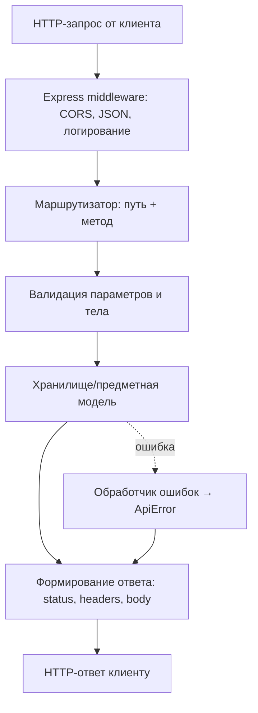
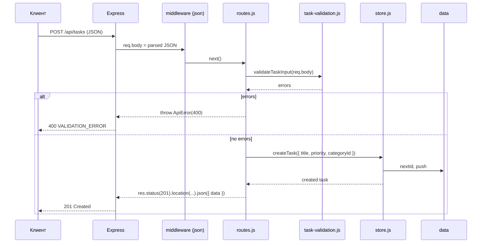

# Лекция № 5. Создание HTTP API на Node.js и Express

**Дисциплина:** Технологии индустриального программирования
**Трек:** фулстек-разработка на JavaScript
**Связанные практические работы:** [ПР9 — Создание собственного HTTP API](../../practices/practice-09/README.md), [ПР10 — Операции изменения данных и интеграция с клиентом](../../practices/practice-10/README.md)
**Демонстрационный пример:** [учебный API на Express](./demo/)

[К описанию курса](../../README.md) · [К ПР9](../../practices/practice-09/README.md) · [К ПР10](../../practices/practice-10/README.md) · [Запустить пример](#13-демонстрационный-пример)

> Центральная идея лекции: серверное приложение — это функция, принимающая HTTP-запрос и возвращающая HTTP-ответ. Разработчик описывает маршруты, проверяет входные данные, обращается к предметной модели и формирует ответ по контракту, а Express берёт на себя разбор запроса, маршрутизацию, middleware и отправку ответа. Это убирает ручную работу с `http.Server` и `req`/`res` на низком уровне, которая была бы основной затратой в чистом `node:http`, и позволяет сосредоточиться на контракте API, валидации и разделении ответственности.

## 1. Место лекции в курсе

В Лекциях 1–4 и практических работах ПР1–ПР8 студенты освоили:

- базовый JavaScript: типы, функции, объекты, массивы, ES-модули (ПР1, ПР2);
- DOM, события, делегирование, формы и `localStorage` (ПР3, ПР4);
- асинхронное программирование, Promise, `fetch`, классификацию ошибок HTTP-клиента (Лекция 3, ПР5, ПР6);
- React как декларативный слой интерфейса: компоненты, `useState`, `useEffect`, кастомные хуки, интеграцию с API (Лекция 4, ПР7, ПР8).

К этому моменту студенты неоднократно обращались к готовому учебному API: сначала из консольного клиента (ПР5), затем из браузерного (ПР6) и, наконец, из React-приложения (ПР8). Контракт API был задан: маршруты `/api/tasks`, `/api/categories`, статусы 200/201/204/400/404/405, единая структура ошибки `{ "error": { "code", "message", "details" } }`. Но сам сервер оставался «чёрным ящиком»: его код не разбирался и не менялся.

Лекция № 5 открывает серверную часть курса. Студенты переходят от потребления API к его созданию. Точка опоры — уже знакомый контракт учебного API: мы показываем, как именно Express-приложение его реализует, какие слои кода отвечают за маршруты, валидацию, выборку данных и формирование ответа. Это позволяет перенести в серверную часть те же принципы разделения ответственности, что применялись в `task-service.js` и `api-client.js`.

Лекция не учит Node.js «с нуля»: студенты уже знают JavaScript, модули и Promise. Лекция вводит именно серверные концепции поверх существующих знаний — `http.Server`, запрос/ответ, middleware, маршрутизация Express, единый формат ошибок, раздельные модули для валидации, хранилища и маршрутов — и связывает их с уже знакомым контрактом `/api/tasks`.

### 1.1. Результаты обучения

После изучения материала необходимо уметь:

1. объяснить различие между браузерным JavaScript и серверным Node.js по доступным глобальным объектам и среде выполнения;
2. описать, что такое HTTP-запрос и HTTP-ответ, и какие их части важны для построения API;
3. использовать Express для регистрации маршрутов `GET`, `POST`, `PATCH`, `DELETE` с параметрами пути и query;
4. объяснить назначение middleware, порядок выполнения и различие между `app.use`, `router.get` и обработчиком ошибок `(err, req, res, next)`;
5. разбирать тело запроса как JSON, проверять `Content-Type` и ограничивать размер тела;
6. проектировать единый формат ошибки с полями `code`, `message`, `details` и приводить любые исключения к нему через обработчик ошибок;
7. различать статусы `200`, `201`, `204`, `400`, `404`, `405`, `413`, `415`, `500` и выбирать правильный для каждой ситуации;
8. разделять модули по ответственности: `validation.js`, `task-service.js`, `store.js`, `routes.js`, `app.js`, `server.js`;
9. применять CORS-заголовки и понимать, когда браузер проверяет origin, а когда нет;
10. реализовывать операции записи (`POST`, `PATCH`, `DELETE`) с атомарностью на уровне одного процесса и назначением идентификаторов сервером;
11. проверять серверные функции и HTTP-маршруты с помощью `node:assert` и `fetch` в Node.js, не запуская отдельного процесса вручную;
12. отлаживать сервер через `console.log`, точки останова в `node --inspect` и вкладку Network браузера для клиентских запросов.

### 1.2. Ориентировочный план занятия

| Этап | Время | Содержание |
|---|---:|---|
| Постановка задачи | 5 минут | Почему готовый API перестаёт быть «чёрным ящиком» и что меняется при переходе на сторону сервера. |
| Node.js и HTTP-сервер | 15 минут | Среда выполнения, `http.Server`, запрос и ответ, заголовки, тело. |
| Express и маршрутизация | 20 минут | Приложение, Router, маршруты, параметры пути и query, методы. |
| Middleware и порядок | 15 минут | `app.use`, `next`, обработчик ошибок, регистрация маршрутов и 404. |
| Валидация и формат ошибок | 15 минут | Параметры и тело запроса, `ApiError`, единый формат ответа ошибки. |
| Операции записи | 15 минут | POST/PATCH/DELETE, статусы, назначение id, атомарность. |
| Разделение ответственности | 10 минут | `validation.js`, `task-service.js`, `store.js`, `routes.js`, `app.js`. |
| Демонстрация и выводы | 5 минут | Разбор работающего примера и подготовка к ПР9–ПР10. |

Распределение времени является ориентиром. При разборе ошибок и вопросов отдельные блоки могут занимать больше времени.

## 2. От клиента к серверу

В Лекции 3 поток данных выглядел так:

```text
клиент (browser/Node.js) → fetch(url) → HTTP-запрос → сервер → HTTP-ответ → response.json()
```

Сервер был внешним источником. Его код не контролировался, и контракт просто соблюдался. В ПР6 и ПР8 готовый учебный сервер использовался как данность.

На стороне сервера поток разворачивается в обратную сторону:

```text
HTTP-запрос → Express → middleware → маршрут → валидация → хранилище → ответ
```

Разработчик уже не вызывает `fetch`, а **принимает** его. Структура `req` и `res` становится не инструментом, а входными и выходными данными. Ключевая смена ракурса: вместо «как сделать запрос» — «как обработать любой запрос по контракту».



Главный сдвиг: вместо «как получить данные» разработчик отвечает на вопрос «какой ответ должен вернуть сервер при любом допустимом запросе». Если запрос неверен, сервер обязан вернуть структурированную ошибку, а не упасть. Это похожая на React декларативность, но на другом уровне: сервер описывает **все возможные ответы** для каждого маршрута, а Express решает, какой именно выполнить.

Это не делает код автоматически корректным: по-прежнему нужно проверять входные данные, обрабатывать ошибки хранилища и соблюдать контракт тела ответа. Но Express убирает целый класс ошибок, связанных с разбором HTTP вручную, и позволяет сосредоточиться на бизнес-логике и контракте API.

## 3. Node.js как среда выполнения

### 3.1. Что уходит из браузера

Node.js исполняет JavaScript вне браузера. Сразу пропадают объекты, которые в браузере кажутся «встроенными»:

| Браузер | Node.js |
|---|---|
| `window`, `document`, `localStorage` | отсутствуют |
| `fetch`, `Response`, `URL` | доступны как глобальные |
| `console` | доступен |
| DOM-события, `addEventListener` | заменяются потоками событий `EventEmitter` |
| `setTimeout`, `setInterval` | доступны |
| ES-модули (`import`/`export`) | доступны через `"type": "module"` в `package.json` |

Вместо `window` в Node.js есть `globalThis` и набор модулей `node:`: `node:http`, `node:fs`, `node:path`, `node:url`, `node:assert`. Их импорт начинается с префикса `node:` — это отделяет встроенные модули от пользовательских пакетов.

### 3.2. Что появляется на сервере

| Понятие | Назначение |
|---|---|
| `process` | Текущий процесс Node.js: `process.argv`, `process.env`, `process.exit()`. |
| `__dirname`, `__filename` | Путь к текущему файлу (в ES-модулях — через `import.meta.url`). |
| `node:fs` | Чтение и запись файлов. |
| `node:http` | Создание HTTP-сервера на низком уровне. |
| `node:path` | Кроссплатформенная работа с путями. |
| `node:url` | `fileURLToPath`, `pathToFileURL`. |

Сервер работает как долгоживущий процесс: он слушает порт и обрабатывает много запросов. В отличие от скрипта, который запускается один раз и завершается, сервер остаётся активным, пока его не остановят (`Ctrl+C` или `process.exit`).

### 3.3. Минимальный HTTP-сервер на `node:http`

```javascript
import { createServer } from "node:http";

const server = createServer((req, res) => {
  res.writeHead(200, { "Content-Type": "text/plain; charset=utf-8" });
  res.end("Привет, мир");
});

server.listen(5505, "127.0.0.1", () => {
  console.log("Сервер: http://127.0.0.1:5505/");
});
```

Этого достаточно, чтобы вернуть строку. Но уже для простого API с пятью маршрутами и четырьмя HTTP-методами код на `node:http` превращается в цепочку `if` по `req.method` и `req.url`, ручной разбор query-строки, ручную отправку заголовков и тела. Это не сложно, но громоздко и неустойчиво к ошибкам.

Express берёт эту рутину на себя. Мы пишем `app.get("/tasks/:id", handler)`, а Express:

- сопоставляет метод и путь с обработчиком;
- извлекает параметры пути в `req.params`;
- предоставляет `req.query`, `req.body` (через middleware);
- даёт методы `res.status()`, `res.json()`, `res.set()`;
- перехватывает синхронные исключения и отклонённые Promise (Express 5).

## 4. Express: приложение и маршруты

**Express** — минималистичный веб-фреймворк для Node.js. Он не навязывает архитектуру, а даёт строительные блоки: приложение, маршрутизатор, middleware, обработчики запросов и ошибок.

```javascript
import express from "express";

const app = express();

app.get("/api/health", (req, res) => {
  res.json({ data: { status: "ok" } });
});

app.listen(5505, "127.0.0.1", () => {
  console.log("API: http://127.0.0.1:5505/api");
});
```

Здесь `app` — приложение Express. `app.get` регистрирует обработчик метода `GET` для пути `/api/health`. Когда приходит запрос `GET /api/health`, Express вызывает функцию, передавая `req` и `res`.

### 4.1. Регистрация маршрутов по методам

Express различает HTTP-методы:

```javascript
app.get("/api/tasks", listTasks);
app.post("/api/tasks", createTask);
app.patch("/api/tasks/:id", updateTask);
app.delete("/api/tasks/:id", deleteTask);
app.all("/api/tasks", methodNotAllowed); // любой метод, не перехваченный выше
```

Для каждого метода — отдельная функция. `app.all` перехватывает любой метод на указанном пути. Это используется для ответа `405 Method Not Allowed`: если `GET /api/tasks` зарегистрирован, а `PUT /api/tasks` — нет, то `app.all("/api/tasks", ...)` вернёт 405.

### 4.2. Параметры пути и query

Параметр пути объявляется через `:name`:

```javascript
app.get("/api/tasks/:id", (req, res) => {
  const id = req.params.id; // строка
});
```

Значение `req.params.id` всегда строка, даже если в URL передано число. Преобразование в число и проверка — задача обработчика.

Query-параметры доступны через `req.query`. Но в Express 5 `req.query` — это уже готовый объект, и проверка повторяющихся параметров требует оригинальной строки. Поэтому в ПР9 предлагается разбирать query вручную:

```javascript
const url = new URL(req.originalUrl, "http://localhost");
const searchParams = url.searchParams;

const values = searchParams.getAll("completed"); // массив
if (values.length > 1) {
  throw new ApiError(400, "INVALID_QUERY", "Параметр completed нельзя повторять.");
}
```

Базовый адрес `"http://localhost"` нужен только для конструирования `URL` — сетевой запрос не выполняется. `searchParams.getAll` позволяет обнаружить повторение, которое Express 5 в готовом `req.query` уже потерял бы.

### 4.3. Router: группировка маршрутов

Когда маршруты, их можно сгруппировать в `Router`:

```javascript
import { Router } from "express";

const router = Router();

router.get("/tasks", listTasks);
router.get("/tasks/:id", getTask);
router.post("/tasks", createTask);

app.use("/api", router); // все маршруты получают префикс /api
```

`app.use("/api", router)` монтирует роутер по префиксу. Запрос `GET /api/tasks` попадёт в `router.get("/tasks", listTasks)`. Это упрощает структуру: маршруты задач и категорий группируются в одном месте, а префикс `/api` задаётся один раз.

### 4.4. Порядок регистрации

Express обрабатывает маршруты в порядке регистрации. Первый совпавший обработчик выполняется, остальные для этого запроса — нет (без вызова `next()`).

```javascript
// Правильно: GET раньше, чем app.all для 405
app.get("/api/tasks", listTasks);
app.all("/api/tasks", methodNotAllowed);

// Неправильно: app.all перехватит и GET
app.all("/api/tasks", methodNotAllowed);
app.get("/api/tasks", listTasks); // никогда не выполнится
```

`app.all` для 405 нужно регистрировать **после** всех конкретных методов на том же пути. Это частая ошибка: если 405 стоит раньше, успешные маршруты перестают работать.

## 5. Middleware и порядок выполнения

**Middleware** — функция с тремя аргументами `(req, res, next)`, которая выполняется для каждого запроса (или для подмножества). Она может изменить `req`/`res`, завершить ответ или передать управление дальше через `next()`.

```javascript
function loggingMiddleware(req, res, next) {
  console.log(`${req.method} ${req.url}`);
  next();
}

app.use(loggingMiddleware);
```

`app.use` регистрирует middleware для всех путей. Можно ограничить путём:

```javascript
app.use("/api", corsMiddleware); // только для /api/*
```

### 5.1. Встроенное middleware `express.json`

Для разбора тела запроса как JSON используется `express.json()`:

```javascript
app.use(express.json({ limit: "16kb" }));
```

Это middleware:
1. Проверяет `Content-Type: application/json`;
2. Читает тело запроса;
3. Помещает результат в `req.body`;
4. Вызывает `next()` для продолжения.

Если `Content-Type` не JSON или тело повреждено, `express.json` передаёт ошибку в `next(error)`, и она попадает в обработчик ошибок.

Важно подключать `express.json` **только** для маршрутов, которые действительно принимают тело. `GET`, `DELETE`, `OPTIONS` не имеют тела; их попытка разобрать тело лишена смысла и может ломать пустые запросы. В ПР10 это делается так:

```javascript
app.post("/api/tasks", jsonBody, createTaskHandler);
app.patch("/api/tasks/:id", jsonBody, patchTaskHandler);
app.delete("/api/tasks/:id", deleteTaskHandler); // без jsonBody
```

### 5.2. Цепочка middleware в маршруте

В обработчик маршрута можно передать несколько middleware:

```javascript
app.post(
  "/api/tasks",
  jsonBodyMiddleware,
  validateTaskInput,
  createTaskHandler,
);
```

Каждое вызывает `next()`, передавая управление следующему. Если `validateTaskInput` находит ошибку, он не вызывает `next()`, а отправляет ответ с `400` — выполнение цепочки прекращается.

### 5.3. Обработчик ошибок

Обработчик ошибок — middleware с четырьмя аргументами:

```javascript
function errorHandler(err, req, res, next) {
  if (err instanceof ApiError) {
    res.status(err.status).json({ error: err.toJSON() });
    return;
  }

  // Ошибки express.json
  if (err.type === "entity.parse.failed") {
    res.status(400).json({ error: { code: "INVALID_JSON", message: "..." } });
    return;
  }

  console.error(err);
  res.status(500).json({ error: { code: "INTERNAL_ERROR", message: "..." } });
}

app.use(errorHandler); // регистрируется ПОСЛЕДНИМ
```

Четыре аргумента — это сигнал Express: «это обработчик ошибок». Он вызывается, когда:
- middleware или маршрут вызвали `next(err)`;
- маршрут выбросил синхронное исключение;
- в Express 5 — когда маршрут вернул отклонённый Promise.

Обработчик ошибок **обязан** приводить любые исключения к единому формату ответа. Иначе клиент получит HTML-страницу с трассировкой стека (в dev-режиме) или пустой ответ — и то, и другое ломает контракт.

### 5.4. Порядок middleware в приложении

Типичный порядок:

```javascript
// 1. Общие заголовки: CORS, no-store
app.use(corsMiddleware);
app.use(noStoreMiddleware);

// 2. Прекомпьют OPTIONS до маршрутов
app.options("*", corsOptionsHandler);

// 3. Маршруты
app.use("/api", router);

// 4. Обработчик 404 для неизвестных путей
app.use(notFoundHandler);

// 5. Обработчик ошибок (последний)
app.use(errorHandler);
```

Если 404 зарегистрирован раньше маршрутов, до них управление не дойдёт. Если обработчик ошибок стоит раньше 404, исключения из 404 попадут обратно в обработчик ошибок, а не будут показаны как 404.

## 6. HTTP-статусы и контракт ответа

### 6.1. Группы статусов

| Группа | Смысл для API | Примеры |
|---|---|---|
| `2xx` | Успех | `200 OK`, `201 Created`, `204 No Content` |
| `3xx` | Перенаправление | `301`, `302` — почти не используются в JSON API |
| `4xx` | Ошибка клиента | `400 Bad Request`, `404 Not Found`, `405 Method Not Allowed`, `413 Payload Too Large`, `415 Unsupported Media Type` |
| `5xx` | Ошибка сервера | `500 Internal Server Error`, `503 Service Unavailable` |

### 6.2. Когда какой статус

| Ситуация | Статус | Тело |
|---|---|---|
| Успешный `GET` коллекции | `200` | `{ data: [...], meta: { total, ... } }` |
| Успешный `GET` одной записи | `200` | `{ data: {...} }` |
| Создана новая запись | `201` | `{ data: {...} }` + заголовок `Location` |
| Удаление записи | `204` | без тела |
| Частичное обновление (`PATCH`) | `200` | `{ data: {...} }` |
| Неверные query или тело | `400` | `{ error: {...} }` |
| Неверный `id` | `400` | `{ error: { code: "INVALID_ID", ... } }` |
| Запись не найдена | `404` | `{ error: { code: "TASK_NOT_FOUND", details: { id } } }` |
| Метод не поддерживается | `405` | заголовок `Allow` |
| Тело слишком большое | `413` | `{ error: { code: "PAYLOAD_TOO_LARGE" } }` |
| Неверный `Content-Type` | `415` | `{ error: { code: "UNSUPPORTED_MEDIA_TYPE" } }` |
| Внутренняя ошибка | `500` | `{ error: { code: "INTERNAL_ERROR" } }` |

### 6.3. Единый формат ошибки

Все ошибки в API возвращаются в одном формате:

```json
{
  "error": {
    "code": "TASK_NOT_FOUND",
    "message": "Задача с id 999 не найдена.",
    "details": { "id": 999 }
  }
}
```

- `code` — стабильный машинный код, по которому клиент строит логику (`TASK_NOT_FOUND`, `VALIDATION_ERROR`, `INVALID_QUERY`, ...). Не меняется между версиями.
- `message` — человекочитаемое описание. Может меняться, клиент не должен на него опираться.
- `details` — необязательные детали (например, `id` отсутствующей задачи или словарь ошибок полей).

Клиент ПР5/ПР8 (Лекция 3) уже опирался на `code`: `error.code === "TASK_NOT_FOUND"` — а не на текст сообщения. Это позволяет серверу менять текст без ломания клиентов.

### 6.4. Класс `ApiError`

Для единообразия используется собственный класс ошибки:

```javascript
export class ApiError extends Error {
  constructor(status, code, message, details = undefined) {
    super(message);
    this.status = status;
    this.code = code;
    this.details = details;
  }

  toJSON() {
    const error = { code: this.code, message: this.message };
    if (this.details !== undefined) error.details = this.details;
    return error;
  }
}
```

Маршрут выбрасывает `ApiError`:

```javascript
if (!task) {
  throw new ApiError(404, "TASK_NOT_FOUND", `Задача с id ${id} не найдена.`, { id });
}
```

Обработчик ошибок приводит его к JSON:

```javascript
res.status(err.status).json({ error: err.toJSON() });
```

Если маршрут выбросил не `ApiError` (например, `TypeError`), обработчик ошибок приводит его к `500 INTERNAL_ERROR` и не отправляет стек клиенту.

## 7. Валидация: параметры и тело запроса

Валидация в API делится на три уровня (как в формах из Лекции 2):

1. **URL и query** — проверка пути, параметров пути (`:id`) и query-параметров (`?completed=false`).
2. **Тело запроса** — проверка JSON-объекта, типов и значений полей.
3. **Бизнес-правила** — существование категории, уникальность `id`.

### 7.1. Параметр пути: положительный целый `id`

URL-параметр — строка, даже если визуально выглядит как число. Необходима проверка:

```javascript
export function parsePositiveId(raw) {
  if (!/^[1-9]\d*$/.test(raw)) return null;
  const value = Number(raw);
  return Number.isSafeInteger(value) ? value : null;
}

// В маршруте:
const id = parsePositiveId(req.params.id);
if (id === null) {
  throw new ApiError(400, "INVALID_ID", "id должен быть положительным целым.");
}
```

Регулярное выражение `/^[1-9]\d*$/` отвергает `0`, `-1`, `01`, `1.5`, `1e2`, `4abc`. Одного `parseInt("4abc")` недостаточно — оно вернёт `4`. Поэтому проверка через регулярное выражение обязательна.

### 7.2. Query-параметры: фильтры списка

```javascript
export function parseFilters(searchParams) {
  const allowed = new Set(["completed", "priority", "categoryId", "q"]);
  for (const name of searchParams.keys()) {
    if (!allowed.has(name)) {
      throw new ApiError(400, "INVALID_QUERY", `Неизвестный параметр: ${name}.`);
    }
  }

  const filters = { completed: null, priority: null, categoryId: null, q: "" };

  const completedValues = searchParams.getAll("completed");
  if (completedValues.length > 1) {
    throw new ApiError(400, "INVALID_QUERY", "Параметр completed нельзя повторять.");
  }
  if (completedValues.length === 1) {
    const raw = completedValues[0];
    if (raw !== "true" && raw !== "false") {
      throw new ApiError(400, "INVALID_QUERY", "completed должен быть true или false.");
    }
    filters.completed = raw === "true";
  }

  // Аналогично для priority, categoryId, q
  return filters;
}
```

Тонкость: `Boolean("false")` равно `true`, потому что любая непустая строка истинна. Поэтому `completed` преобразуется только после проверки на `"true"`/`"false"`, а не через `Boolean(raw)`.

`null` означает «фильтр не передан», `false` — «значение false». Это разные состояния, и проверка `if (filters.completed)` пропустила бы `false`. Поэтому в выборке используется строгое сравнение:

```javascript
if (filters.completed !== null && task.completed !== filters.completed) return false;
```

### 7.3. Тело POST: проверка полей

```javascript
export function validateTaskInput(body, { partial = false, categoryIds } = {}) {
  if (!body || typeof body !== "object" || Array.isArray(body)) {
    return { body: "Тело запроса должно быть JSON-объектом." };
  }

  const allowed = partial
    ? new Set(["title", "completed", "priority", "categoryId"])
    : new Set(["title", "priority", "categoryId"]);
  const errors = Object.create(null);

  for (const name of Object.keys(body)) {
    if (!allowed.has(name)) errors[name] = "Неизвестное поле.";
  }

  if ("title" in body) {
    if (typeof body.title !== "string" || body.title.trim().length < 1 || body.title.trim().length > 100) {
      errors.title = "Название должно содержать от 1 до 100 символов.";
    }
  }
  if (!partial && !("title" in body)) {
    errors.title = "Обязательное поле.";
  }

  // Аналогично для priority, categoryId, completed
  return errors;
}
```

`Object.create(null)` создаёт словарь без прототипа, чтобы имя `__proto__` работало как обычный ключ. `Object.hasOwn(body, "completed")` проверяет наличие поля надёжнее, чем `body.completed !== undefined` (последнее пропускает явно переданный `undefined`).

В режиме `partial` (PATCH) пропущенные поля не считаются ошибкой — они будут сохранены. В режиме полного запроса (POST) обязательные поля должны присутствовать.

Все ошибки собираются в один ответ, а не возвращаются по одной:

```json
{
  "error": {
    "code": "VALIDATION_ERROR",
    "message": "Данные не прошли проверку.",
    "details": {
      "title": "Название обязательно.",
      "categoryId": "Неизвестная категория."
    }
  }
}
```

Это удобно клиенту: пользователь видит сразу все проблемы формы, а не по одной за раз.

### 7.4. Где валидация не должна выполняться

Валидация не должна:
- отправлять HTTP-ответ напрямую — это задача маршрута;
- читать `req` или писать в `res` — это связывает её с Express;
- обращаться к хранилищу — это работа предметного слоя.

Чистая функция `validateTaskInput(body, options) -> errors` тестируется в Node.js без HTTP. Маршрут вызывает её, и если `Object.keys(errors).length > 0`, выбрасывает `ApiError(400, "VALIDATION_ERROR", ..., errors)`.

## 8. Операции записи: POST, PATCH, DELETE

### 8.1. POST: создание ресурса

```javascript
app.post("/api/tasks", jsonBody, (req, res, next) => {
  const errors = validateTaskInput(req.body, { categoryIds });
  if (Object.keys(errors).length > 0) {
    throw new ApiError(400, "VALIDATION_ERROR", "Данные не прошли проверку.", errors);
  }

  const task = store.createTask({
    title: req.body.title.trim(),
    priority: req.body.priority,
    categoryId: req.body.categoryId,
  });

  res.status(201)
    .location(`/api/tasks/${task.id}`)
    .json({ data: task });
});
```

Ключевые моменты:

- **`id` и `completed` назначает сервер**. Их передача в теле POST запрещена, даже если значение совпадает. Это защищает от конфликтов и сохраняет контроль над идентификаторами.
- **`201 Created`** — правильный статус для создания. Не `200`.
- **Заголовок `Location`** указывает URL созданного ресурса. Это часть HTTP-контракта, его читает клиент через `response.headers.get("location")`.
- **Тело ответа содержит созданную запись** с назначенными `id` и `completed: false`.

### 8.2. PATCH: частичное обновление

```javascript
app.patch("/api/tasks/:id", jsonBody, (req, res, next) => {
  const id = parsePositiveId(req.params.id);
  if (id === null) throw new ApiError(400, "INVALID_ID", "...");

  const existing = store.getTask(id);
  if (!existing) throw new ApiError(404, "TASK_NOT_FOUND", "...", { id });

  const errors = validateTaskInput(req.body, { partial: true, categoryIds });
  if (Object.keys(errors).length > 0) {
    throw new ApiError(400, "VALIDATION_ERROR", "...", errors);
  }

  const updated = store.updateTask(id, req.body);
  res.json({ data: updated });
});
```

PATCH изменяет **только переданные поля**. Не переданные поля сохраняются. Это реализуется через объединение:

```javascript
const updated = { ...existing, ...changes, id: existing.id };
```

`id` всегда берётся из `existing`, а не из `changes` — это гарантирует, что клиент не сможет его изменить.

Порядок проверок важен:
1. `id` — если неверный, нет смысла читать тело.
2. Существование записи — если нет, тело не валидируется.
3. Тело — если неверное, запись не меняется.

Это избегает лишней работы и соответствует контракту: `PATCH /api/tasks/4abc` без тела возвращает `400 INVALID_ID`, а не `400 INVALID_JSON`.

### 8.3. DELETE: удаление

```javascript
app.delete("/api/tasks/:id", (req, res, next) => {
  const id = parsePositiveId(req.params.id);
  if (id === null) throw new ApiError(400, "INVALID_ID", "...");

  const removed = store.deleteTask(id);
  if (!removed) throw new ApiError(404, "TASK_NOT_FOUND", "...", { id });

  res.status(204).end();
});
```

DELETE возвращает **`204 No Content`** без тела. `res.status(204).end()` отправляет пустой ответ. Попытка `res.json(null)` добавит `Content-Type: application/json` и нарушит контракт.

Повторное удаление той же записи возвращает `404 TASK_NOT_FOUND`, а не `204` — после первого удаления запись больше не существует.

### 8.4. Назначение идентификаторов сервером

```javascript
let nextId = Math.max(...tasks.map((t) => t.id)) + 1;

function createTask(data) {
  const task = { id: nextId, ...data, completed: false };
  nextId += 1;
  tasks.push(task);
  return { ...task };
}
```

`nextId` хранится в памяти процесса и увеличивается при каждом успешном создании. Удаление **не уменьшает** счётчик — это защищает от повторного использования id удалённой записи. Ошибка валидации **не должна** вызывать `createTask`, иначе `nextId` расходуется зря.

В пределах одного процесса создание синхронно, поэтому гонки нет. Но это **не транзакция**: при переходе к PostgreSQL в ПР11–ПР12 понадобятся `SERIAL`/`GENERATED ALWAYS AS IDENTITY` и реальная транзакция.

### 8.5. Атомарность на уровне процесса

Хранилище в памяти одного процесса делает операции атомарными по построению: JavaScript однопоточный, и обработчик выполняется до конца без прерывания другим обработчиком. Но это не защищает от:

- нескольких процессов (балансировщик): разные процессы имеют разную память и разный `nextId`;
- аварийного завершения: данные в памяти теряются при `process.exit`;
- нескольких одновременных клиентов: теоретически можно начать обрабатывать второй запрос до завершения первого, но в Express синхронный код одного обработчика не прерывается.

В ПР10 все эти ограничения обговорены явно. Постоянное хранение и многопроцессная работа относятся к ПР11–ПР14 (PostgreSQL, Docker).

## 9. Хранилище и предметная модель

### 9.1. Слои от маршрута до данных

```text
HTTP-обработчик (routes.js)
        ↓
валидация параметров и тела (validation.js, task-validation.js)
        ↓
предметная модель (task-service.js): поиск, фильтрация, бизнес-правила
        ↓
хранилище (store.js): массивы в памяти, copy-on-read
        ↓
исходные данные (data.js): замороженный учебный набор
```

Каждый слой имеет одну ответственность:

| Слой | Отвечает за | Не должен делать |
|---|---|---|
| `data.js` | Исходные 12 задач и 3 категории, замороженные. | Менять данные, знать HTTP. |
| `store.js` | Хранение конкретного приложения, copy-on-read, операции записи. | Формировать HTTP-ответ, знать про валидацию. |
| `task-service.js` | Чистые функции поиска и фильтрации по переданному массиву. | Читать `req`, отправлять `res`, обращаться к глобальному состоянию. |
| `validation.js` | Разбор и проверка параметров URL и query. | Трогать `req`/`res`, знать про предметную область. |
| `task-validation.js` | Проверка тела POST/PATCH, нормализация, ошибки полей. | Знать про `store`, HTTP. |
| `routes.js` | Связь HTTP с логикой, формирование ответа. | Хранить глобальный массив, дублировать правила валидации. |
| `app.js` | Сборку middleware и Router. | Открывать порт при импорте. |
| `server.js` | Порт и запуск приложения. | Реализовывать маршруты. |

Это та же послойная архитектура, что в ПР2 (`task-service.js`), ПР3 (`task-view.js`) и Лекции 4 (`useTaskData`): предметная модель не знает о транспорте, транспорт не знает о хранилище. Разница — в наборе слоёв: вместо DOM-слоя появляется HTTP-слой.

### 9.2. Почему `task-service.js` не знает про Express

Если бы `task-service.js` импортировал `express` или обращался к `req`/`res`, его нельзя было бы:
- проверить в Node.js без HTTP-сервера;
- переиспользовать в другом транспорте (WebSocket, CLI, тестовый сценарий);
- запускать в изоляции от Express-приложения.

Поэтому `task-service.js` экспортирует чистые функции:

```javascript
export function findTask(tasks, id) {
  return tasks.find((t) => t.id === id) ?? null;
}

export function selectTasks(tasks, filters) {
  return tasks.filter((t) => {
    if (filters.completed !== null && t.completed !== filters.completed) return false;
    if (filters.priority !== null && t.priority !== filters.priority) return false;
    if (filters.categoryId !== null && t.categoryId !== filters.categoryId) return false;
    if (filters.q && !t.title.toLocaleLowerCase("ru-RU").includes(filters.q.toLocaleLowerCase("ru-RU"))) return false;
    return true;
  });
}
```

Эти функции идентичны тем, что были в `task-service.js` ПР2 и в учебном сервере ПР5/ПР8 — предметная модель переносится без изменений.

### 9.3. Copy-on-read

Хранилище возвращает **копии** записей, а не ссылки:

```javascript
export function getTask(id) {
  const task = tasks.find((t) => t.id === id);
  return task ? { ...task } : null;
}
```

Если бы `getTask` возвращал сам объект из массива, изменение результата в маршруте изменило бы серверные данные. Это нарушает инкапсуляцию и ломает тесты. Поэтому — копия через spread.

Для `updateTask`:

```javascript
export function updateTask(id, changes) {
  const index = tasks.findIndex((t) => t.id === id);
  if (index < 0) return null;
  const updated = { ...tasks[index], ...changes, id };
  tasks[index] = updated;
  return { ...updated };
}
```

Внутри массива сохраняется новый объект (старый замещается), наружу возвращается ещё одна копия. Это избыточно для учебного проекта, но подчёркивает принцип: никто снаружи не может случайно изменить хранилище.

### 9.4. Учебный `reset`

Для удобства тестов и клиента ПР8 в ПР10 есть маршрут `POST /api/debug/reset`:

```javascript
app.post("/api/debug/reset", (req, res) => {
  store.reset();
  res.json({ data: { reset: true, total: store.listTasks().length } });
});
```

Он восстанавливает исходные 12 задач и сбрасывает `nextId`. Это не часть боевого API — учебная операция для локального сервера. В продакшене такого маршрута быть не должно.

## 10. CORS и HEAD, OPTIONS

### 10.1. Что такое CORS

CORS (Cross-Origin Resource Sharing) — механизм браузера. Сервер **не** проверяет origin на своей стороне: он отправляет заголовки, а браузер уже решает, дать ли JavaScript доступ к ответу.

Origin определяется схемой, хостом и портом:
- `http://127.0.0.1:5505` и `http://127.0.0.1:5173` — разные origin.
- `http://127.0.0.1:5505` и `https://127.0.0.1:5505` — разные origin (разные схемы).

В учебном API разрешаем все origin:

```javascript
function corsMiddleware(req, res, next) {
  res.set("Access-Control-Allow-Origin", "*");
  res.set("Access-Control-Allow-Methods", "GET, HEAD, POST, PATCH, DELETE, OPTIONS");
  res.set("Access-Control-Allow-Headers", "Accept, Content-Type");
  res.set("Access-Control-Expose-Headers", "Location");
  res.set("Access-Control-Max-Age", "600");
  next();
}
```

`Access-Control-Expose-Headers: Location` нужен, чтобы клиентский JavaScript мог прочитать заголовок `Location` из ответа на `POST` (по умолчанию браузер открывает только «безопасные» заголовки).

### 10.2. Preflight OPTIONS

Перед «нестандартным» запросом (например, `POST` с `Content-Type: application/json`) браузер отправляет предварительный `OPTIONS`:

```javascript
app.options("*", (req, res) => {
  res.status(204).end();
});
```

`OPTIONS` возвращает 204 без тела и CORS-заголовки, поставленные `corsMiddleware`. Браузер смотрит на `Access-Control-Allow-Methods` и решает, можно ли отправлять основной запрос.

`OPTIONS` нужно обрабатывать **до** маршрутов и **до** 405. Иначе preflight получит 405 вместо 204 и не даст браузеру отправить основной запрос.

### 10.3. HEAD

`HEAD` — это «то же, что `GET`, но без тела». Express автоматически обрабатывает `HEAD` для зарегистрированных `GET`-маршрутов, если нет отдельного обработчика `HEAD`. Сервер возвращает те же заголовки (включая `Content-Length`), но без тела.

Поэтому в ПР9 и ПР10 не нужно регистрировать отдельные `app.head(...)` — достаточно `app.get(...)`.

### 10.4. CORS — не авторизация

`Access-Control-Allow-Origin: *` означает «любой origin может читать ответы этого API из браузера». Это **не** означает «любой клиент может делать любые запросы». Авторизация (токены, сессии) — отдельный слой, в ПР9–ПР10 его нет. Учебный API не имеет учётных данных, поэтому `*` допустимо.

В боевых API с авторизацией `*` обычно не используется: либо указывается конкретный origin, либо используется `null` для same-origin. Но это тема отдельной лекции.

## 11. Разделение ответственности в Express-приложении

Главное преимущество Express — свобода в архитектуре. Минус — легко всё смешать в одном файле. Структура ПР9–ПР10 повторяет слои из предыдущих работ:

| Файл | Ответственность | Знает ли о Express? |
|---|---|---|
| `data.js` | Замороженные исходные данные. | Нет. |
| `store.js` | Хранилище в памяти, copy-on-read, операции записи. | Нет. |
| `task-service.js` | Чистые функции поиска и фильтрации. | Нет. |
| `validation.js` | Разбор `id` и query-параметров. | Только `URL`/`URLSearchParams`, не Express. |
| `task-validation.js` | Проверка тела POST/PATCH. | Нет. |
| `errors.js` | `ApiError` и обработчик ошибок. | Да (обработчик — middleware). |
| `routes.js` | Регистрация `GET`/`POST`/`PATCH`/`DELETE`. | Да. |
| `write-routes.js` | Обработчики записи (ПР10). | Да. |
| `app.js` | Сборка middleware, монтирование Router. | Да. |
| `server.js` | `app.listen`, порт, запуск. | Да. |

`task-service.js` из ПР2 переносится в `domain/` без изменений. Это важный момент: предметный код не зависит от транспорта и переиспользуется в любой среде, от консоли до Express.

### 11.1. Почему `app.js` отделён от `server.js`

```javascript
// app.js
export function createApp() {
  const app = express();
  app.use(corsMiddleware);
  app.use("/api", router);
  app.use(notFound);
  app.use(errorHandler);
  return app;
}
```

```javascript
// server.js
import { createApp } from "./app.js";
const app = createApp();
app.listen(5505, "127.0.0.1", () => console.log("..."));
```

`createApp()` возвращает приложение без открытия порта. Это позволяет тестам открыть сервер на свободном порту и закрыть его после проверок:

```javascript
import { createServer } from "node:http";
import { createApp } from "../src/app.js";

const app = createApp();
const server = app.listen(0, "127.0.0.1"); // 0 = случайный свободный порт
const { port } = server.address();
const baseUrl = `http://127.0.0.1:${port}/api`;

// Тесты используют baseUrl и fetch...
await fetch(`${baseUrl}/tasks`);

server.close();
```

Не нужно мокировать весь HTTP-слой или обращаться к запущенному вручную серверу. Каждый тестовый набор создаёт свой сервер на свободном порту.

### 11.2. Поток одного действия

Рассмотрим `POST /api/tasks` в Express-приложении:



Каждый слой отвечает за свою часть: middleware разбирает тело, маршрут валидирует и формирует ответ, валидатор проверяет данные, хранилище меняет массив. Слои не перемешиваются.

## 12. Отладка Express-приложения

Express-приложение отлаживается теми же инструментами, что и обычный JavaScript, плюс HTTP-специфика.

### 12.1. `console.log` и middleware

Простейший способ увидеть, что приходит на сервер:

```javascript
app.use((req, res, next) => {
  console.log(`${req.method} ${req.originalUrl}`, req.body);
  next();
});
```

Это middleware, который печатает каждый запрос и его тело (если уже разобрано). Полезно для быстрой проверки: приходит ли запрос, какие заголовки, какое тело.

### 12.2. `node --inspect`

```bash
node --inspect src/server.js
```

Открывает DevTools в Chrome по адресу `chrome://inspect`. Можно поставить точку останова в обработчике, посмотреть `req`, `res`, локальные переменные, стек вызовов.

В VS Code: `F5` с конфигурацией launch для Node.js. Тоже работает с точками останова.

### 12.3. Network в браузере

Клиент ПР8 делает запросы к серверу ПР10. Вкладка Network в DevTools показывает:
- URL и метод;
- заголовки запроса и ответа;
- тело запроса и ответа;
- статус и время;
- заголовок `Location` для `POST`.

Это основной инструмент для отладки клиент-серверного взаимодействия: видно, что именно клиент отправил и что сервер вернул.

### 12.4. Частые симптомы

| Симптом | Вероятная причина | Что проверить |
|---|---|---|
| `EADDRINUSE` | Порт занят другим процессом | `lsof -i :5505` (Unix) или `netstat -ano \| findstr 5505` (Windows); остановить другой сервер или выбрать другой порт. |
| `Cannot set headers after they are sent` | После `res.json()` или `res.end()` продолжается ветвь | `return` после `res.json()`, не отправлять два ответа. |
| `Cannot read property 'id' of undefined` | `req.body` не разобран | Подключён ли `express.json` для этого маршрута? Правильный ли `Content-Type` в запросе? |
| 404 на существующий маршрут | Маршрут зарегистрирован после 404-обработчика | Порядок `app.use`: маршруты раньше `app.use(notFound)`. |
| 405 на разрешённый метод | `app.all` для 405 стоит раньше `app.get` | Порядок: конкретные методы раньше `app.all`. |
| OPTIONS получает 405 | `OPTIONS` обработчик стоит после маршрутов | `app.options("*", ...)` раньше `app.use("/api", router)`. |
| `req.body` — строка | `Content-Type` не `application/json` | Клиент отправляет правильный заголовок; `express.json` его пропускает. |
| CORS-ошибка в браузере | Нет `Access-Control-Allow-Origin` | `corsMiddleware` подключён и ставит заголовок на все ответы. |
| TypeError: `app.listen` is not a function | Импортирован не тот объект | `import express from "express"; const app = express();` — `express` это функция. |
| POST создаёт `undefined` | Не вызвано `next()` в `jsonBody` | middleware должен вызвать `next()` для передачи управления. |
| Двойной ответ | После throw продолжается код | Использовать `return` перед `throw` в async-обработчике; Express 5 ловит отклонённые Promise. |

### 12.5. Проверка через интеграционные тесты

Интеграционный тест запускает сервер на свободном порту и делает реальные HTTP-запросы:

```javascript
import assert from "node:assert/strict";
import { createApp } from "../src/app.js";

const app = createApp();
const server = app.listen(0, "127.0.0.1");
const { port } = server.address();
const baseUrl = `http://127.0.0.1:${port}/api`;

const response = await fetch(`${baseUrl}/tasks?completed=false`);
const payload = await response.json();

assert.equal(response.status, 200);
assert.equal(payload.data.length, 7);

server.close();
```

Это самый честный тест: он проходит весь стек от HTTP до хранилища. Если такой тест зелёный, велика вероятность, что и реальный клиент заработает.

Модульные тесты проверяют отдельные функции:

```javascript
import assert from "node:assert/strict";
import { parsePositiveId } from "../src/validation.js";

assert.equal(parsePositiveId("4"), 4);
assert.equal(parsePositiveId("0"), null);
assert.equal(parsePositiveId("4abc"), null);
```

Они быстрые и точечные, но не показывают, что сервер в целом работает. Поэтому применяются оба набора: модульные для деталей, интеграционные для всего стека.

## 13. Демонстрационный пример

В каталоге [`demo`](./demo/) находится учебный Express-сервер «Управление задачами». Он показывает:

- маршруты `GET /api/health`, `GET /api/categories`, `GET /api/tasks`, `GET /api/tasks/:id`;
- операции записи `POST`, `PATCH`, `DELETE`;
- middleware: CORS, JSON, логирование;
- единый формат ошибок через `ApiError` и обработчик ошибок;
- разделение на `validation.js`, `task-service.js`, `store.js`, `routes.js`, `app.js`, `server.js`;
- учебный `POST /api/debug/reset` для сброса состояния;
- интеграционный набор проверок через `node:test`.

### 13.1. Состав примера

| Файл | Назначение |
|---|---|
| `app.js` | Сборка приложения Express, middleware, монтирование Router. |
| `server.js` | Запуск сервера на порту 5505. |
| `data.js` | Замороженные исходные данные: 12 задач и 3 категории. |
| `store.js` | Хранилище в памяти с copy-on-read и операциями записи. |
| `task-service.js` | Чистые функции поиска и фильтрации. |
| `validation.js` | Разбор `id` и query-параметров. |
| `task-validation.js` | Проверка тела POST/PATCH. |
| `errors.js` | `ApiError` и обработчик ошибок. |
| `routes.js` | GET-маршруты и сброс. |
| `write-routes.js` | POST/PATCH/DELETE. |
| `package.json` | Зависимости и команды. |
| `checks/server.test.js` | Интеграционные проверки. |

### 13.2. Запуск

Из каталога `lectures/lecture-05/demo`:

```bash
npm install
npm start
```

Затем открыть:

```text
http://127.0.0.1:5505/api/health
http://127.0.0.1:5505/api/tasks
http://127.0.0.1:5505/api/tasks?completed=false&priority=high
http://127.0.0.1:5505/api/categories
```

Для запуска проверок:

```bash
npm test
```

### 13.3. Сценарий демонстрации

1. Запустить сервер и открыть `http://127.0.0.1:5505/api/health` — увидеть `{ "data": { "status": "ok" } }`.
2. Открыть `http://127.0.0.1:5505/api/tasks` — увидеть 12 задач.
3. Открыть `http://127.0.0.1:5505/api/tasks?completed=false&priority=high` — увидеть отфильтрованный список.
4. Открыть `http://127.0.0.1:5505/api/tasks/4` — увидеть одну задачу.
5. Открыть `http://127.0.0.1:5505/api/tasks/999` — увидеть `404 TASK_NOT_FOUND` с `details: { id: 999 }`.
6. Открыть `http://127.0.0.1:5505/api/tasks/4abc` — увидеть `400 INVALID_ID`.
7. Использовать `curl` или Postman для `POST /api/tasks` с JSON-телом:
   ```bash
   curl -X POST http://127.0.0.1:5505/api/tasks \
     -H "Content-Type: application/json" \
     -d '{"title":"Проверить POST","priority":"high","categoryId":2}'
   ```
   Увидеть `201 Created` с заголовком `Location: /api/tasks/35` и созданной задачей в теле.
8. Сделать `PATCH /api/tasks/35` с телом `{"completed":true}` — увидеть обновлённую задачу с сохранёнными `title`, `priority`, `categoryId`.
9. Сделать `DELETE /api/tasks/35` — увидеть `204 No Content` без тела.
10. Повторить `DELETE /api/tasks/35` — увидеть `404 TASK_NOT_FOUND`.
11. Сделать `POST /api/debug/reset` — состояние восстановится.
12. Запустить `npm test` — все проверки должны пройти.

Демонстрационный пример показывает архитектурный принцип, но не является готовым решением ПР9 или ПР10: предметная область, контракты функций, структура модулей и проверяемые требования практических работ отличаются.

## 14. Связь с практическими работами

### ПР9: Создание собственного HTTP API

В ПР9 основные идеи лекции применяются к собственному серверу:

- устанавливается Express и запускается учебный сервер;
- реализуются `validation.js`, `task-service.js`, `routes.js`;
- поддерживаются `GET /api/health`, `/api/categories`, `/api/tasks`, `/api/tasks/:id`;
- фильтры списка: `completed`, `priority`, `categoryId`, `q` с проверкой повторений и неизвестных параметров;
- единый формат ошибок через `ApiError` и обработчик ошибок;
- `HEAD` и `OPTIONS` с CORS-заголовками;
- `405` для неподдерживаемых методов на известных путях;
- `404` для неизвестных маршрутов;
- автоматические проверки: модульные (`check:unit`) и HTTP (`check:api`).

### ПР10: Операции изменения данных и интеграция с клиентом

В ПР10 сервер получает операции записи:

- реализуются `task-validation.js`, `store.js` (с `createTask`/`updateTask`/`deleteTask`), `write-routes.js`;
- `POST /api/tasks` создаёт задачу с назначенным сервером `id` и `201` + `Location`;
- `PATCH /api/tasks/:id` частично обновляет поля и возвращает `200`;
- `DELETE /api/tasks/:id` возвращает `204`;
- серверная валидация тела: типы, обязательные поля, неизвестные поля, существование категории;
- `VALIDATION_ERROR` с `details` по каждому неверному полю;
- `INVALID_JSON` для повреждённого тела, `413` для слишком большого, `415` для неверного `Content-Type`;
- `nextId` не уменьшается при удалении и не расходуется при ошибке валидации;
- React-клиент ПР8 подключается к собственному серверу ПР10;
- после каждой мутации клиент повторно выполняет `GET` с текущими фильтрами;
- автоматические проверки: `read-unit`, `read-api`, `write-unit`, `write-api`, `integration`.

Главный переход между работами: ПР9 отвечает на вопрос «как принимать запросы и формировать ответы», а ПР10 — «как изменять данные и связать это с клиентом».

| Концепция лекции | ПР9 | ПР10 |
|---|---|---|
| Express-приложение и middleware | ✓ основа | ✓ переиспользуется |
| Маршруты `GET` и параметры пути | ✓ основа | ✓ переиспользуется |
| Query-параметры и фильтры | ✓ основа | ✓ переиспользуется |
| Единый формат ошибок `ApiError` | ✓ основа | ✓ расширяется |
| `404`/`405`/`400` | ✓ основа | ✓ расширяется |
| `POST`/`PATCH`/`DELETE` | — | ✓ основа |
| Валидация тела JSON | — | ✓ основа |
| Назначение `id` сервером | — | ✓ основа |
| `201`/`204` и `Location` | — | ✓ основа |
| Подключение React-клиента | — | ✓ основа |
| `task-service.js` как чистые функции | ✓ переиспользован | ✓ переиспользован |
| Контракт API из ПР6 | ✓ переиспользован | ✓ переиспользован |

## 15. Итоги

1. Node.js исполняет JavaScript вне браузера: нет `window`, `document`, `localStorage`, но есть `node:http`, `node:fs`, `process`, `node:assert`.
2. Express берёт на себя разбор HTTP-запроса, маршрутизацию, middleware и отправку ответа, освобождая внимание для контракта API и бизнес-логики.
3. Маршрут — это `(method, path, handler)`. `req.params`, `req.query`, `req.body` — вход, `res.status().json()` — выход.
4. Middleware — функция `(req, res, next)`. `next()` передаёт управление дальше; отсутствие `next()` завершает цепочку.
5. Обработчик ошибок — middleware с четырьмя аргументами `(err, req, res, next)`. Обязан приводить любые исключения к единому формату ответа.
6. Единый формат ошибки: `{ error: { code, message, details? } }`. `code` — стабильный машинный код, `message` — человекочитаемое описание.
7. Статусы: `200` (успех), `201` (создание), `204` (удаление), `400` (неверный запрос), `404` (не найдено), `405` (метод не поддерживается), `413` (тело слишком велико), `415` (неверный `Content-Type`), `500` (внутренняя ошибка).
8. Валидация делится на три уровня: URL/query, тело JSON, бизнес-правила. Каждый уровень — отдельный модуль.
9. POST создаёт ресурс: `id` и `completed` назначает сервер, ответ `201` + `Location`. PATCH обновляет только переданные поля, ответ `200`. DELETE возвращает `204` без тела.
10. `nextId` не уменьшается при удалении и не расходуется при ошибке валидации. В памяти одного процесса операции атомарны, но это не транзакция.
11. Разделение ответственности: `data.js` — данные, `store.js` — хранилище, `task-service.js` — чистые функции, `validation.js`/`task-validation.js` — проверка, `routes.js`/`write-routes.js` — HTTP, `app.js` — сборка, `server.js` — запуск.
12. `createApp()` без открытия порта позволяет тестам запускать сервер на свободном порту и закрывать его после проверок.
13. CORS — правило браузера, не сервера. `Access-Control-Allow-Origin` и `OPTIONS`-preFlight нужны для клиентского JavaScript из другого origin.
14. `HEAD` автоматически обрабатывается Express для `GET`-маршрутов. `OPTIONS` нужно зарегистрировать раньше маршрутов.
15. Отладка: `console.log` middleware, `node --inspect`, Network в браузере, интеграционные тесты через `fetch` к свободному порту.

## 16. Контрольные вопросы

1. Чем серверный JavaScript отличается от браузерного по доступным глобальным объектам?
2. Почему для построения API выбирают Express, а не пишут на чистом `node:http`?
3. Что такое middleware, и как `next()` управляет порядком выполнения?
4. Чем обработчик ошибок `(err, req, res, next)` отличается от обычного middleware?
5. Зачем `app.use` для middleware и `app.get`/`app.post` для маршрутов — это разные функции?
6. Почему `req.params.id` — строка, и как проверить, что это положительное целое?
7. Почему `Boolean("false")` равно `true`, и как это влияет на разбор query-параметра `completed`?
8. Как `searchParams.getAll` помогает обнаружить повторяющиеся параметры?
9. Зачем нужен единый формат ошибки `{ error: { code, message, details } }`?
10. Чем `code` отличается от `message` в ошибке API, и на что должен опираться клиент?
11. Почему `201 Created` правильнее, чем `200 OK`, для `POST`, создающего ресурс?
12. Зачем в ответе на `POST` заголовок `Location`, и кто его читает?
13. Почему `DELETE` возвращает `204` без тела, а не `200` с JSON?
14. Почему `id` и `completed` назначает сервер, а не клиент?
15. Что означает «PATCH частично обновляет», и как это реализуется через spread?
16. Почему `nextId` не уменьшается при удалении?
17. Зачем `Object.create(null)` для словаря ошибок полей?
18. Зачем `Object.hasOwn(body, "completed")` вместо `body.completed !== undefined`?
19. Почему `express.json` подключается только к `POST` и `PATCH`, а не глобально?
20. Чем `405` отличается от `404`, и в каком порядке регистрировать обработчики?
21. Почему `OPTIONS` нужно обрабатывать раньше маршрутов?
22. Что такое preflight-запрос, и когда браузер его отправляет?
23. Почему `Access-Control-Allow-Origin: *` не авторизация?
24. Зачем `createApp()` отделён от `server.js`?
25. Как интеграционный тест запускает сервер на свободном порту, и зачем это нужно?
26. Какие слои в Express-приложении не должны знать про `req`/`res`, и почему?
27. Что меняется при переходе от памяти процесса к PostgreSQL (ПР11–ПР12)?

## 17. Материалы и источники

| Тема | Документация |
|---|---|
| Node.js | [Node.js documentation][node-docs], [HTTP][node-http], [File system][node-fs], [Assertion][node-assert] |
| Express | [Express: Getting started][express-start], [Routing][express-routing], [Writing middleware][express-mw], [Using middleware][express-use-mw], [Error handling][express-errors] |
| HTTP | [MDN: HTTP overview][mdn-http], [HTTP response status codes][mdn-status], [HTTP request methods][mdn-methods] |
| URL и query | [MDN: `URL`][mdn-url], [`URLSearchParams`][mdn-urlsearchparams] |
| CORS | [MDN: CORS][mdn-cors], [Express CORS middleware][express-cors] |
| JSON | [MDN: JSON][mdn-json], [`JSON.parse`][mdn-parse], [`JSON.stringify`][mdn-stringify] |
| REST | [REST API Tutorial][rest-tutorial], [MDN: REST][mdn-rest] |
| Тестирование | [Node.js test runner][node-test], [`node:assert/strict`][node-assert-strict] |
| Доп. пособие | [dv0retsky/js-tutorial][base-course], разделы об асинхронном коде, HTTP и модулях |

[node-docs]: https://nodejs.org/api/
[node-http]: https://nodejs.org/api/http.html
[node-fs]: https://nodejs.org/api/fs.html
[node-assert]: https://nodejs.org/api/assert.html
[node-test]: https://nodejs.org/api/test.html
[node-assert-strict]: https://nodejs.org/api/assert.html#strict-assertion-mode
[express-start]: https://expressjs.com/en/starter/installing-template.html
[express-routing]: https://expressjs.com/en/guide/routing.html
[express-mw]: https://expressjs.com/en/guide/writing-middleware.html
[express-use-mw]: https://expressjs.com/en/guide/using-middleware.html
[express-errors]: https://expressjs.com/en/guide/error-handling.html
[express-cors]: https://expressjs.com/en/resources/middleware/cors.html
[mdn-http]: https://developer.mozilla.org/en-US/docs/Web/HTTP/Guides/Overview
[mdn-status]: https://developer.mozilla.org/en-US/docs/Web/HTTP/Reference/Status
[mdn-methods]: https://developer.mozilla.org/en-US/docs/Web/HTTP/Reference/Methods
[mdn-url]: https://developer.mozilla.org/en-US/docs/Web/API/URL
[mdn-urlsearchparams]: https://developer.mozilla.org/en-US/docs/Web/API/URLSearchParams
[mdn-cors]: https://developer.mozilla.org/en-US/docs/Web/HTTP/Guides/CORS
[mdn-json]: https://developer.mozilla.org/en-US/docs/Web/JavaScript/Reference/Global_Objects/JSON
[mdn-parse]: https://developer.mozilla.org/en-US/docs/Web/JavaScript/Reference/Global_Objects/JSON/parse
[mdn-stringify]: https://developer.mozilla.org/en-US/docs/Web/JavaScript/Reference/Global_Objects/JSON/stringify
[rest-tutorial]: https://restfulapi.net/
[mdn-rest]: https://developer.mozilla.org/en-US/docs/Glossary/REST
[base-course]: https://github.com/dv0retsky/js-tutorial
